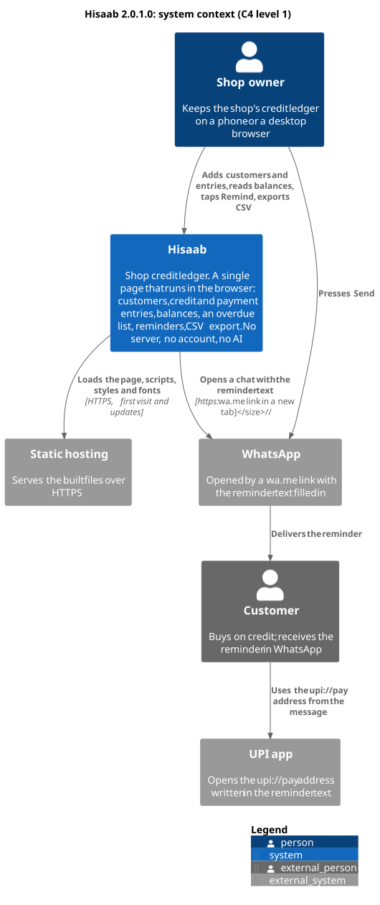
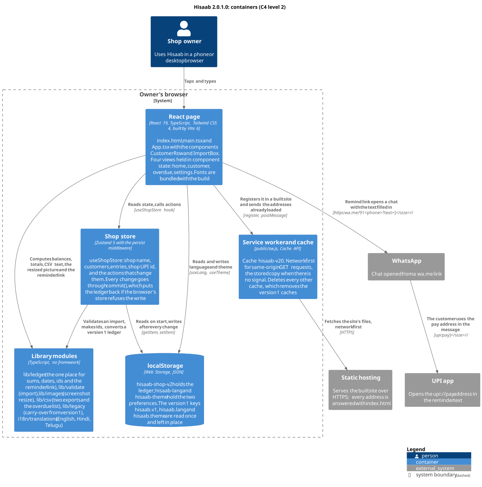
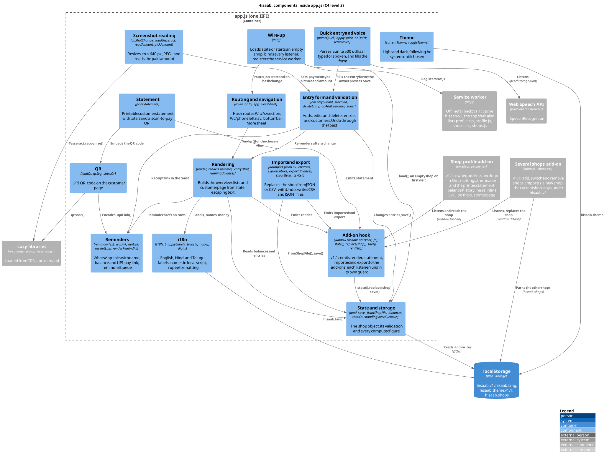

# Hisaab: architecture

This page describes version 1.5.2, the version on the live link.

Hisaab is a shop credit ledger that runs as one web page in the browser. The site is a set of static files:
HTML, CSS and plain JavaScript, with no framework and no build step. Hisaab has no server of its own:
everything a shop records stays in the browser of the device, in `localStorage`
([where data is kept](docs/data-model.md#where-data-is-kept)). The hosting only hands out the files. Three
things do reach another party, each only when the owner uses that feature; they are listed under
[Security and privacy](#security-and-privacy).

## Context

The shop owner opens the site in a browser on a phone or a computer. The customer never opens the ledger: the
customer gets a message in WhatsApp or by SMS, and pays through a UPI app. Hisaab does not send a message
itself. It builds a link, the owner taps it, and the other app opens with the text or the payment filled in.

## Containers

Everything inside the boundary runs in the owner's browser.

- The ledger page: `index.html` with `app.js`, which holds the state, the sums, the routes and the forms.
- The add-on scripts, loaded after `app.js`, each adding one feature to the page.
- The pay page `pay.html`, a separate small page that a reminder links to.
- The service worker `sw.js` with its cache, for use offline.
- `localStorage`, the only place the shop's records are kept.

## Components

`app.js` is one script. Its parts are: start, state and ledger, text and names, drawing, routes, the entry and
customer forms, quick entry and voice, reminders and pay links, QR, statement, import and export, screenshot,
theme, and the add-on hook.

### How add-ons hook into `app.js`

`app.js` ends by setting `window.Hisaab`. Every add-on begins by reading it and stops at once if it is not
there, so the ledger works without any of them.

- An add-on listens with `Hisaab.on(name, fn)`. The events are `render` (after every draw), `statement` (after
  a statement is built), `imported` (after a shop is loaded) and `export` (the backup object, before it is
  downloaded, so an add-on can add fields). Each listener runs inside `try/catch`, so a fault in one add-on
  does not stop the ledger.
- It reads and changes the shop through `state()`, `replace(next)`, `save` and `render()`.
- It reads the sums through `balances()`, `overdue()` and the frozen `ledger` object, and the text through
  `text(key, vars)`, `lang()`, `addLanguage(code, table)` and `quickWords(...)`.
- `window.hisaabParseQuick(text)` returns what quick entry understood from a sentence
  ([its shape](docs/schema/quick-entry-result.schema.json)).

The routes are hash routes: `#/` for the overview, `#/s/<section>` for one section (`record`, `customers`,
`overdue`, `recent`, `add`, `data`, `settings`) and `#/c/<10 digits>` for one customer. What a person does on
each screen is in [the journeys](docs/journeys.md).

## The files

`index.html` loads the style sheets in this order: `fonts/fonts.css`, `styles.css`, `profile.css`,
`shops.css`, `extras.css`, `customer.css`, `polish.css`, `brand.css`, `compact.css`. It loads the scripts at
the end of the body in this order: `sample.js`, `app.js`, `profile.js`, `shops.js`, `langs.js`, `extras.js`,
`customer.js`, `names.js`, `sendways.js`, `wacheck.js`, `assist.js`, `guard.js`, `compact.js`.

| File | Job |
| --- | --- |
| `index.html` | The one page: top bar, left navigation, home view, customer view, phone bottom bar, More sheet, toast, print area. An inline script sets the theme from `hisaab.theme` before the page draws |
| `pay.html` | The pay page a reminder links to. It has its own inline style and script, links `fonts/fonts.css` and `brand.css`, and builds a `upi://pay` link from the part of the address after `#` |
| `app.js` | The ledger: text in English, Hindi and Telugu, name transliteration, state, storage, import (JSON and CSV), balances, overdue, drawing, routes, quick entry, voice, screenshot, export, statement, theme, and `window.Hisaab` |
| `sample.js` | A copy of the sample shop, used when `sample-data.json` cannot be fetched |
| `sample-data.json` | The sample shop "Lakshmi Provision Store (fictional)": 8 customers, 38 entries |
| `profile.js`, `profile.css` | Shop profile (owner, address, logo) and the "Balance over time" chart on the customer page. Hooks: `render`, `statement`, `imported`, `export` |
| `shops.js`, `shops.css` | More than one shop on one device. Hooks: `render`, `imported`, and the browser's `storage` event |
| `langs.js` | Adds nine languages to the language box and fetches a language file from `i18n/` when one is chosen |
| `extras.js`, `extras.css` | Note shortcut chips, the overdue total line, the date the figures are for. Hook: `render` |
| `customer.js`, `customer.css` | "More for this customer": totals, call, WhatsApp chat, change phone number, delete with undo. Hook: `render` |
| `names.js` | A customer's name written in the script of the nine newer languages. It sets `Hisaab.nameIn`, which `app.js` calls |
| `sendways.js` | "Other ways to send" a reminder (SMS, choose a contact, copy), the demo UPI notice, the sample number note. Hook: `render` |
| `wacheck.js` | The WhatsApp check of a customer's number. Hooks: `render`, `imported` |
| `assist.js` | The theme button says which theme is on, the navigation says which view, the skip link moves the focus, quick entry offers to add an unknown name. It listens on the page after the app's own listeners |
| `guard.js`, `guard.css` | Storage full or blocked notices, the imported picture limit, the date kept on an edit, whole rupees. Hooks: `render`, `imported`, the entry form's submit. `guard.js` adds the link to `guard.css` itself |
| `compact.js`, `compact.css` | The compact chat layout: quick entry pill, the "+" menu, the summary strip on a phone, the right panel on a desktop, right to left for Urdu. Hook: `render` |
| `styles.css` | Base styles, light and dark, print |
| `polish.css` | Layout fixes for long labels at every width |
| `brand.css` | Brand colours and fonts: Fraunces for headings, Inter for body text |
| `sw.js` | The service worker (offline) |
| `manifest.webmanifest` | The name, colours and icon used when the site is installed on a home screen |
| `icon.svg`, `brand-mark.svg` | The app icon and the brand mark in the top bar |
| `vendor/` | `qrcode.min.js`, the QR library, with its licence file. Loaded when a QR code or a statement is first drawn |
| `fonts/` | `fonts.css` and 16 `.woff2` files (Fraunces, Inter, Baloo 2, Noto Sans, Noto Sans Devanagari, Noto Sans Telugu), with their licence texts |
| `i18n/` | 12 JSON files, one per language: `en`, `hi`, `te`, `bn`, `mr`, `ta`, `gu`, `kn`, `ml`, `pa`, `or`, `ur` |

Why each technology was chosen is in [the tech stack](TECH-STACK.md#choices).

## Hosting

The site is served as static files from `https://hisaab-hazel.vercel.app`. There is no build step, no rewrite
rule, no function and no server code, and the code reads no environment variable. A `.vercelignore` file keeps
the brief, the brand folder, the tests and the notes out of the deploy. How to run and release it is in
[the implementation plan](IMPLEMENTATION-PLAN.md).

## Offline

`sw.js` is registered when the page loads on https or on localhost. Its cache is named `hisaab-v22`; older
caches are deleted when a new worker takes over.

- It answers every GET for the site's own files from the network first, keeps a copy of each good answer, and
  uses the last copy when the network fails. A page request with no copy gets `index.html`.
- On install it precaches 47 entries: the page, `pay.html`, every script and style sheet in the table above,
  `sample-data.json`, the manifest, the two SVG files, `vendor/qrcode.min.js`, `fonts/fonts.css` and the 16
  font files.
- The `i18n/` files are not precached. Each is cached the first time it is fetched.

| Works offline after one visit online | Does not work offline |
| --- | --- |
| Opening the app with its data, recording, editing, search, balances, overdue | Reading the amount from a screenshot: the reader comes from a CDN and is never cached. The picture is still attached |
| The QR code and the statement | Voice entry: the browser's speech service needs the internet |
| Import and export | A newer language that was never used online: the app shows English |
| English, Hindi and Telugu, and any newer language already used once | Delivery of a reminder: WhatsApp and SMS need their own connection |

## Security and privacy

- There is no account, no sign-in, no analytics and no form posted anywhere. The code makes no request to
  another host except the one named below.
- What leaves the device, and when:
  1. When a screenshot is chosen, the browser fetches the screenshot reader (Tesseract.js 5.1.1) from
     `cdn.jsdelivr.net`, and the reader fetches its own engine and language data. The picture itself is read
     in the browser.
  2. When the microphone button is pressed, the browser's speech service is used. In most browsers this sends
     the spoken audio to the browser maker.
  3. When the owner taps a link, another app or tab opens: WhatsApp (`https://wa.me/...`), SMS (`sms:`), the
     dialer (`tel:`), a UPI app (`upi://pay`) or `https://sai4b.com`. A reminder holds the customer's name,
     the shop name, the balance, the UPI ID and the pay links, and goes only when the owner presses Send in
     that app. [The link formats](docs/schema/links.md) are on their own page.
- The link to `pay.html` carries the shop, the customer's name, the UPI ID and the amount after `#`, a part of
  an address that a browser does not send to a server.
- Text from the owner and from imported files is escaped before it is drawn. Exported CSV cells that start
  with `=`, `+`, `-`, `@`, a tab or a return get a leading `'`, so a spreadsheet does not run them as a
  formula.
- Anyone who can open the browser on the device can read the ledger; there is no lock inside the app.

## Accessibility

A skip link moves the focus to the ledger. `assist.js` says in a hidden status line which theme is on and
which view has opened. The "+" menu is a menu for assistive tools, with arrow keys, Home, End and Escape.
The app follows the device's light or dark setting until the owner chooses, and respects reduced motion.

## Languages

Twelve languages. English, Hindi and Telugu are inside `app.js`; Bengali, Marathi, Tamil, Gujarati, Kannada,
Malayalam, Punjabi, Odia and Urdu are each one file in `i18n/`, fetched when chosen. Each language file has
256 text keys in six groups: `core` 159, `profile` 15, `shops` 15, `customer` 38, `extras` 10, `compact` 19.
A missing key falls back to English. The messages of `guard.js` exist in English, Hindi and Telugu only.

Urdu is written right to left: `compact.js` sets `dir="rtl"` on the page, and mirrors the arrow keys and the
position of the "+" menu. Amounts and balances keep their left-to-right order. Hindi and Telugu digits are an
option in Shop settings. Voice entry and screenshot reading have language codes for English, Hindi and Telugu.

## Layout breakpoints

| Width | Layout (`compact.js`, `compact.css`) |
| --- | --- |
| Up to 767 px | Phone: the quick entry pill is fixed at the bottom with a "+" button and a send button, the bottom bar, a one-row summary under the total |
| 768 px and up | Desktop: left navigation, the quick entry pill at the bottom of the main column with its own "+" |
| 1200 px and up | A right panel holds the entry form, Overdue and Recent entries, each list with a filter box |

`styles.css` and `polish.css` add finer steps for very narrow phones, wide screens and print.

## Known risks

See [known limits](REPORT.md#known-limits).
