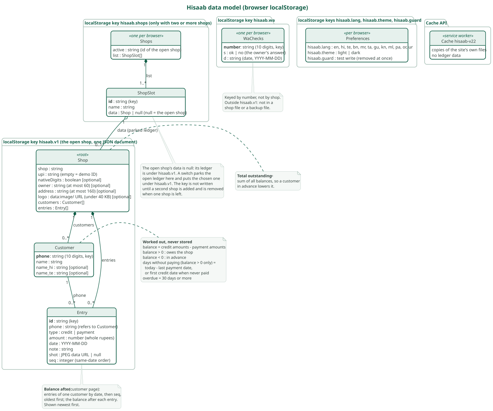
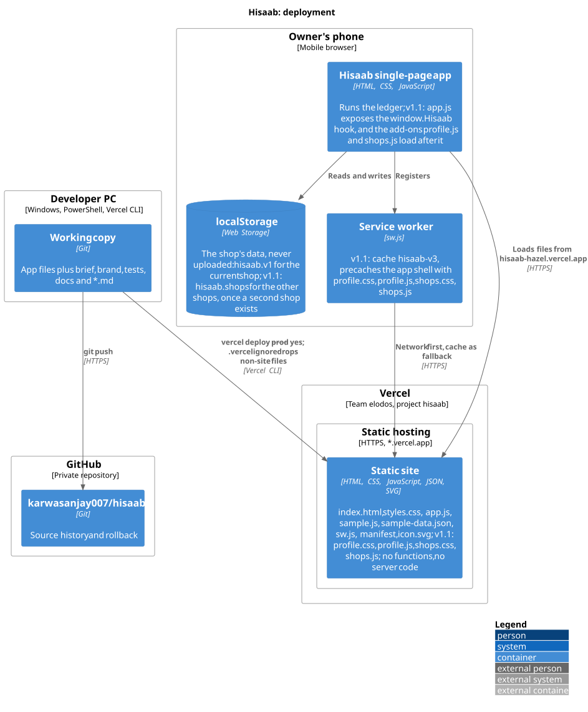

# Hisaab: architecture

| | |
| --- | --- |
| Product | Hisaab, a shop credit ledger (khata) for a local kirana shop |
| Version described | 2.0.1.0, live since 27 Nov 2026 |
| Code | private repository; the version 1 code is kept there under `legacy/` and no longer runs |
| Last revised | 27 Nov 2026, written from the code of 2.0.1.0 |

Diagrams are C4 (PlantUML with the bundled C4 library), kept as `.puml` sources in `docs/diagrams/` and
rendered to SVG with `java -jar plantuml.jar -tsvg -charset UTF-8 docs/diagrams/<name>.puml`.

## Contents

1. [Overview and goals](#1-overview-and-goals)
2. [Constraints and decisions](#2-constraints-and-decisions)
3. [Context](#3-context)
4. [Containers](#4-containers)
5. [Components](#5-components)
6. [Runtime views](#6-runtime-views)
7. [Data](#7-data)
8. [Deployment](#8-deployment)
9. [Cross-cutting concerns](#9-cross-cutting-concerns)
10. [Quality and testing](#10-quality-and-testing)
11. [Risks and known limits](#11-risks-and-known-limits)
12. [What changed from version 1](#12-what-changed-from-version-1)
13. [Glossary](#13-glossary)

## 1. Overview and goals

Hisaab lets a shop owner keep who owes what: customers, credit given, payments received, the balance of
each customer and the total outstanding. It runs entirely in the browser. There is no server code, no
account, no database outside the browser and no AI.

What 2.0.1.0 does:

- Add a customer (name, 10-digit phone, no duplicate phone); search by name or phone.
- Record a credit or a payment with an amount in whole rupees, a date, a note and an optional payment
  screenshot; edit an entry; delete one, with Undo.
- Show every customer's balance, highest first, and the total outstanding.
- Customer page: balance, days since the last payment, entries newest first.
- Overdue view: every customer who owes, the longest without a payment first.
- A Remind link per customer that opens WhatsApp with the text filled in and, when money is owed, a
  `upi://pay` address.
- Load a shop file (JSON pasted into a box); export two CSV files.
- English, Hindi and Telugu; light and dark theme; opens with no signal after the first visit.
- Carries over a ledger, language and theme saved by version 1 on the first open.

## 2. Constraints and decisions

| Decision | Reason |
| --- | --- |
| No backend; data in `localStorage` | The shop's data stays on the owner's device; nothing to host or secure |
| Vite 6, React 19, TypeScript 5.7, Tailwind CSS 4, Zustand 5 | The stack of the 2.0 rebuild; one small page, typed, with a tested library of pure functions |
| One place for sums: `lib/ledger` | The total, the rows, the CSV and the reminder all use `signedAmount()` and `balanceOf()`, so they cannot disagree |
| No balance is stored | A balance is always computed from the entries |
| A change is shown only if it was written | `commit()` in the store puts the ledger back when the browser's store refuses the write |
| Amounts are whole rupees | No fractions to round; an import with a fraction is refused |
| Fonts bundled with the build | No request to a font service; the page works offline after one visit |
| Network first in the service worker | A new release is never hidden behind a stored copy |
| The tester's hooks are kept | `#total-outstanding`, `[data-customer]`, `[data-balance]`, `[data-remind]`, `#import-box`, `#import-go`, `#shot-input`, `[data-shot]`, `?today=` |

## 3. Context

Source: [c4-context.puml](docs/diagrams/c4-context.puml). The owner is the only user. Two outside systems
are reached, both by a link the owner or the customer taps: WhatsApp (`https://wa.me/...`) and a UPI app
(the `upi://pay` address written inside the reminder text). Hisaab calls no API.

## 4. Containers

Source: [c4-container.puml](docs/diagrams/c4-container.puml).

| Container | What it is |
| --- | --- |
| React page | `index.html`, `src/main.tsx`, `src/App.tsx`, `src/components/`. Four views held in component state (home, customer, overdue, settings); there are no routes |
| Shop store | `src/store/useShopStore.ts`, Zustand with the `persist` middleware, key `hisaab-shop-v2` |
| Library modules | `src/lib/` (ledger, validate, images, csv, legacy, types) and `src/i18n/translations.ts` |
| localStorage | `hisaab-shop-v2`, `hisaab-lang`, `hisaab-theme`; the version 1 keys are read once and left in place |
| Service worker | `public/sw.js`, cache `hisaab-v20` |

## 5. Components

Source: [c4-component.puml](docs/diagrams/c4-component.puml).

| Module | Responsibility |
| --- | --- |
| `main.tsx` | Loads the fonts, renders `App`, registers `/sw.js` in a built site and posts it the addresses already loaded |
| `App.tsx` | Header (theme button, language list), status line with Undo, total, the four views, the forms, the bottom navigation, CSV download |
| `components/CustomerRow` | One customer row: name, phone, balance, Remind link |
| `components/ImportBox` | The import text box, its button and its error |
| `hooks/useLang` | Current language and `t(key, vars)`; English is the fallback |
| `hooks/useTheme` | Light or dark; follows the system until the owner chooses |
| `i18n/translations` | The text in English, Hindi and Telugu |
| `store/useShopStore` | State (`shop`, `customers`, `entries`, `shopUpi`, plus `importError`, `statusMessage`, `lastDeleted` in memory) and the actions `importJson`, `addCustomer`, `addEntry`, `updateEntry`, `deleteEntry`, `undoDelete`, `setShopUpi`; `commit()` rolls back a refused write |
| `lib/ledger` | `signedAmount`, `balanceOf`, `totalOutstanding`, `entriesNewestFirst`, `daysSinceLastPayment`, `customersByHighestBalance`, `formatRs`, `todayFromUrl`, `calendarToday`, `reminderHref`, `newId`, `importIds` |
| `lib/validate` | `validateImport`: checks a pasted shop file, returns clean data or the first error |
| `lib/images` | `resizeToDataUrl`: a picture fitted inside 600 px, as JPEG under 150,000 characters |
| `lib/csv` | `balancesCsv`, `entriesCsv`, `overdueList` |
| `lib/legacy` | `legacyToV2` converts a version 1 ledger; `readKey` and `writeKey` guard storage that may be blocked |

## 6. Runtime views

The journeys, each with a sequence diagram, are in [docs/journeys.md](docs/journeys.md): first open, record
an entry, WhatsApp reminder, overdue list, load a shop file and export, payment screenshot, language and
offline.

## 7. Data

Source: [data-model.puml](docs/diagrams/data-model.puml). Field rules:
[stored-state.schema.json](docs/schema/stored-state.schema.json) (what is stored),
[shop-file.schema.json](docs/schema/shop-file.schema.json) (what the import box accepts),
[export-entries.csv.md](docs/schema/export-entries.csv.md) (the two CSV files) and
[links.md](docs/schema/links.md) (the WhatsApp and UPI links).

An entry points to its customer by phone. `lastDeleted`, `statusMessage` and `importError` are kept in memory
only (`partialize` in the store leaves them out), so Undo does not survive a reload.

## 8. Deployment

Source: [deployment.puml](docs/diagrams/deployment.puml). `npm run build` runs `tsc -b` and `vite build`
and writes `dist/` (`index.html`, `assets/` with hashed script, style and font files, `icon.svg`, `sw.js`).
`vercel.json` names the build command, the output folder and one rewrite: every address is answered with
`/index.html`. The site is static files only. To go back, the previous production deployment is promoted on
the host.

## 9. Cross-cutting concerns

### Security and privacy

The ledger, the screenshots and the preferences stay in the browser's `localStorage`. Nothing is uploaded and
no third-party script, font service or analytics is loaded. A reminder leaves the device only when the owner
presses Send in WhatsApp. React escapes all text it renders; an imported picture is kept only if it is a
`data:image/` URL of at most 400,000 characters.

### Accessibility

A skip link to the ledger; a status line with `role="status"` and `aria-live="polite"` that announces saves,
the theme and a press on the current navigation item; errors with `role="alert"`; labels on every field;
controls at least 44 px high; `aria-current="page"` on the navigation; the page's `lang` attribute follows the
language; balances carry a plain-digit copy for screen readers and tests.

### Performance

One script and one style file, hashed by the build; fonts bundled. Lists are derived with `useMemo`.
Screenshots are shrunk before they are stored.

### Internationalisation

Three languages: English, Hindi, Telugu, in one table. A missing key falls back to English. The reminder
text is written in the chosen language; the figure is always written `Rs 3,470`. Import errors and the
"Imported N customers." line are English only.

### Responsive layout

One column, at most `max-w-3xl` wide, with a fixed bottom navigation of three items (Home, Overdue,
Settings) at every width.

### Offline

`public/sw.js` is registered only in a built site. On activation it deletes every cache except `hisaab-v20`
(this removes the version 1 caches) and claims the page. The page posts the addresses it has already loaded,
so one visit is enough. Same-origin GET requests go to the network first and a good response is stored; with
no signal the stored copy is returned, matched by address (the query is ignored for a page), and a page with
no copy gets the stored `/`.

## 10. Quality and testing

| Layer | Where | Count at 2.0.1.0 |
| --- | --- | --- |
| Unit (Vitest, jsdom) | `src/lib/ledger.test.ts`, `src/lib/fixes.test.ts`, `src/store/store.test.ts`, `src/store/quota.test.ts` | 32 tests |
| End to end (Playwright, on the built site) | `e2e/hooks.spec.ts`, `e2e/fixes.spec.ts` | 17 tests |
| Live checker | the hidden-data checker on the live link, two seeds | 25 pass, 1 fail (the screenshot amount reader, not built) |

Commands: `npm test`, `npm run build`, `npm run test:e2e`. The version 1 test scripts target features that
were not rebuilt and do not apply.

## 11. Risks and known limits

- `localStorage` belongs to one browser on one device: clearing site data deletes the ledger, and there is no
  JSON backup export in 2.0.1.0 (only the two CSV files).
- Screenshots share the same store; they are capped in size, and a full store refuses the save with a message.
- Undo covers the last deleted entry only and is lost on reload. An import replaces the whole ledger and has
  no Undo.
- WhatsApp does not make a `upi://` address tappable in every app; the customer may need to copy it.
- Until the owner sets the shop's UPI id in Settings, the pay address uses the demo id `hisaab.demo@upi`.
- Only the active shop of version 1 is carried over; other shops parked by version 1 are not read.
- Not tested: other browsers, a real phone.

## 12. What changed from version 1

Version 1 (1.0.0.0 to 1.2.5.0) was plain HTML, CSS and JavaScript with add-on script files. 2.0 is a rebuild.
Not rebuilt, and so not in this page or its diagrams: nine more languages, voice and typed quick entry, the
screenshot amount reader, several shops, the shop profile, other ways to send, the WhatsApp check, the pay
page and QR code, the printed statement, CSV import, JSON export, sample-shop button, deep links and the wide
layout. The storage key changed from `hisaab.v1` to `hisaab-shop-v2`; the cache from `hisaab-v10` to
`hisaab-v20`.

## Code files (version 2.0.1.0)

Every file that runs, one line each. The 1.x files are in `legacy/` and do not run.

| File | What it holds |
| --- | --- |
| `index.html` | The one page; it loads `src/main.tsx` |
| `public/sw.js` | The service worker: network first, a copy for offline, cache `hisaab-v20`; it replaces the 1.x worker at the same address |
| `src/main.tsx` | Starts the page, loads the bundled fonts, registers the service worker in a built site |
| `src/App.tsx` | The page: home, customer, overdue and settings views; the forms; the status line and Undo |
| `src/index.css` | Colours, fonts and the few styles Tailwind does not give |
| `src/components/CustomerRow.tsx` | One customer row with its balance and its WhatsApp reminder link (the grader hooks) |
| `src/components/ImportBox.tsx` | The import box and button (`#import-box`, `#import-go`) |
| `src/hooks/useLang.ts` | The chosen language, remembered; the text lookup |
| `src/hooks/useTheme.ts` | Light or dark, remembered, following the device until chosen |
| `src/i18n/translations.ts` | Every label in English, Hindi and Telugu |
| `src/lib/ledger.ts` | The one place for sums: the sign of an entry, balance, total, newest first, days since the last payment, the reminder link, ids |
| `src/lib/validate.ts` | Import: checks a shop file and turns it into the stored shape |
| `src/lib/images.ts` | A screenshot resized to fit 600 px and kept small |
| `src/lib/legacy.ts` | Reads the ledger, language and theme that 1.x saved, once |
| `src/lib/csv.ts` | The two CSV exports and the overdue list |
| `src/lib/types.ts` | The shapes of a customer, an entry and the shop |
| `src/store/useShopStore.ts` | The ledger in memory and in the browser store; nothing is kept that the store refused |

## 13. Glossary

| Term | Meaning |
| --- | --- |
| Khata | The shop's credit ledger |
| Credit | Goods given on credit; adds to what the customer owes |
| Payment | Money received; takes away from what the customer owes |
| Balance | Credit minus payments for one customer; below zero is an advance |
| Total outstanding | The sum of every customer's balance |
| Overdue | A customer who owes, listed by days since the last payment |
| UPI | India's instant payment system; a `upi://pay` address opens a UPI app |
| Shop file | The JSON pasted into the import box |
