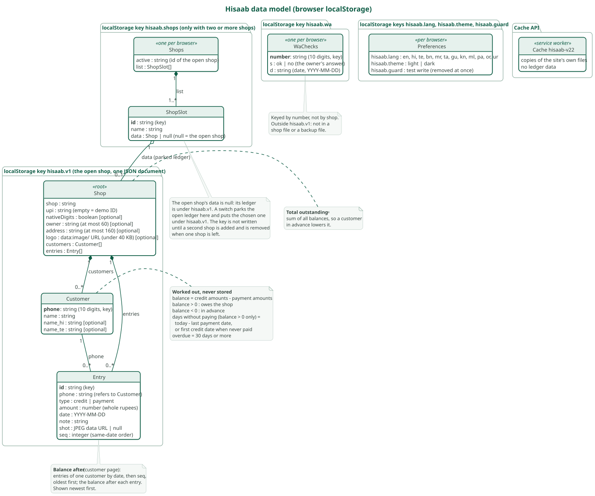

# Hisaab data model

Hisaab keeps one shop's ledger in the browser's `localStorage`. There is no server and no database. This page
describes what version 2.0.1.0 stores, how the pieces relate and how every figure on screen is worked out. The
source of truth is `src/lib/types.ts`, `src/store/useShopStore.ts` and `src/lib/ledger.ts`.

The diagram source is `diagrams/data-model.puml`. The stored shape is also given as a schema in
[schema/stored-state.schema.json](schema/stored-state.schema.json).

## Entities

| Entity | Key | Fields |
| --- | --- | --- |
| Shop | one per browser | `shop` (name, text; empty for a new ledger), `shopUpi` (text, empty until set), `customers` (in the order added or imported), `entries` |
| Customer | `phone` (10 digits, unique) | `name` (text, not empty), `phone` |
| Entry | `id` (text) | `phone` (a customer's phone), `type` (`credit` or `payment`), `amount` (whole rupees, above 0), `date` (`YYYY-MM-DD`), `note` (text, may be empty), `shot` (optional image data URL) |

An entry belongs to the customer with the same phone. A customer holds no balance field.

## Derived values

Nothing below is stored. Each is worked out from the entries every time the screen is drawn.

| Value | Rule |
| --- | --- |
| Signed amount | credit adds the amount, a payment takes it away |
| Balance | the sum of a customer's signed amounts; below zero is an advance |
| Total outstanding | the sum of every balance; advances lower it |
| Entry order | date, newest first; on the same date the larger id first |
| Days since the last payment | whole days from the latest payment date to today; with no payment, from the earliest entry; no entries, no figure |
| Overdue list | customers with a balance above zero, most days first, then by name |
| Home list | highest balance first, then by name |
| Today | `?today=YYYY-MM-DD` in the address when present, otherwise the device's date |
| Money text | "Rs 3,82,853", Indian grouping |

## localStorage keys

| Key | Written by | Holds |
| --- | --- | --- |
| `hisaab-shop-v2` | 2.0 | `{"state": {"shop", "customers", "entries", "shopUpi"}, "version": 0}`, the shape Zustand's `persist` writes |
| `hisaab-lang` | 2.0 | `en`, `hi` or `te` |
| `hisaab-theme` | 2.0 | `light` or `dark`, only after the owner has pressed the theme button; until then the device setting is followed |
| `hisaab.v1` | 1.x | The 1.x ledger. Read once, never changed |
| `hisaab.lang` | 1.x | Read when `hisaab-lang` is absent and the value is `en`, `hi` or `te` |
| `hisaab.theme` | 1.x | Read when `hisaab-theme` is absent |

The entry removed last (for Undo), the status line and the import error are held in memory only.

Keys that 1.x wrote and 2.0 never reads: `hisaab.shops` (several shops) and `hisaab.wa` (answers to the WhatsApp
check). They stay in the browser untouched.

## Carry-over from 1.x

On first open, when `hisaab-shop-v2` is absent and `hisaab.v1` holds a ledger, the ledger is copied into
`hisaab-shop-v2`. The old copy is left where it was.

- Customers: a name and a 10-digit phone are needed; a repeated phone is skipped.
- Entries: a known phone, a type of `credit` or `payment`, an amount above zero and a `YYYY-MM-DD` date are needed. A row that fails is skipped; the rest of the ledger is kept.
- The 1.x field `upi` becomes `shopUpi`. A picture is kept when it is an image data URL.
- Only the active shop is carried over. Profile fields and the other shops are not.

## Entry ids

| Made by | Shape | Why |
| --- | --- | --- |
| A new entry | `<time in base 36>-n<six digits>-<four characters>` | Sorts by the time it was made; a counter separates entries of the same millisecond |
| An import | `<time in base 36>-i<six digits>` | The six digits are the row's place in the file, so a later row counts as newer |
| Carry-over | the id 1.x gave it, or `v1-<six digits>` | |

On the same date a new entry sorts above imported rows of the same millisecond, because "n" comes after "i".

## Storage limits and screenshots

- A chosen screenshot is redrawn to fit inside 600 px on both sides (never enlarged) on a white ground and saved as JPEG at quality 0.75. While its data URL is over 150,000 characters the quality is lowered in steps of 0.1, down to about 0.35.
- A picture in an imported file is kept only when it is an image data URL of 400,000 characters or fewer; otherwise the entry is kept without it.
- Every change goes through one function in the store. If the browser refuses the write (store full), the ledger is put back as it was and the action returns "Storage is full"; nothing is shown as saved.
- If storage is blocked altogether, the page still opens; language and theme are not remembered.

## Import validation, in short

An import replaces the shop's name, customers and entries. `shopUpi` is a setting and is not changed by an import.

| Rule | On failure |
| --- | --- |
| The text is valid JSON and an object | Refused, nothing changed |
| `customers` is a list; `entries` is a list or absent | Refused |
| Each customer has a name and a 10-digit phone (a number is accepted); no phone twice | Refused, the message names the row |
| Each entry has a known 10-digit phone, a type of `credit` or `payment`, a positive whole amount (digits in a string are accepted, a fraction is not) and a `YYYY-MM-DD` date | Refused, the message names the row |
| `shop` absent or empty | The name becomes "Shop" |

Import messages are in English in every language.

## Offline cache

The service worker keeps a copy of what the page loads in one cache, `hisaab-v20`. It holds files of the site only, never ledger data. Caches of 1.x are removed when the worker takes over.

## CSV exports

| File | Columns |
| --- | --- |
| `hisaab-balances.csv` | `phone,name,balance` |
| `hisaab-entries.csv` | `phone,name,date,type,amount,note,running_balance`, oldest first for each customer |
