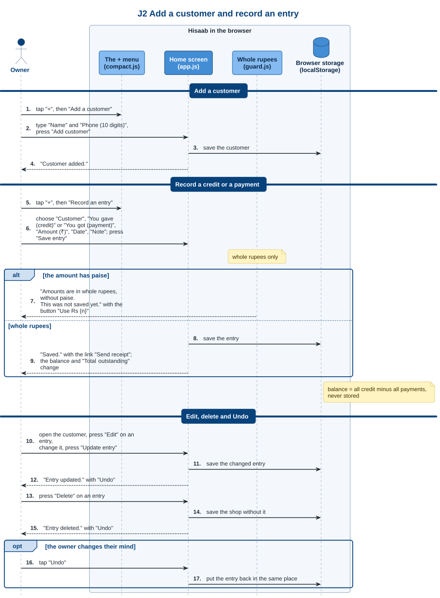
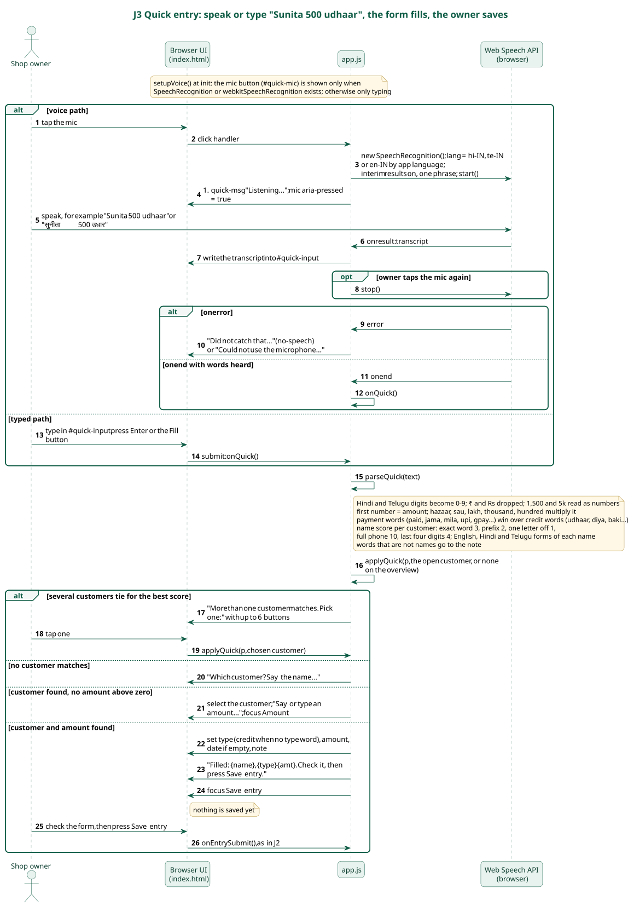
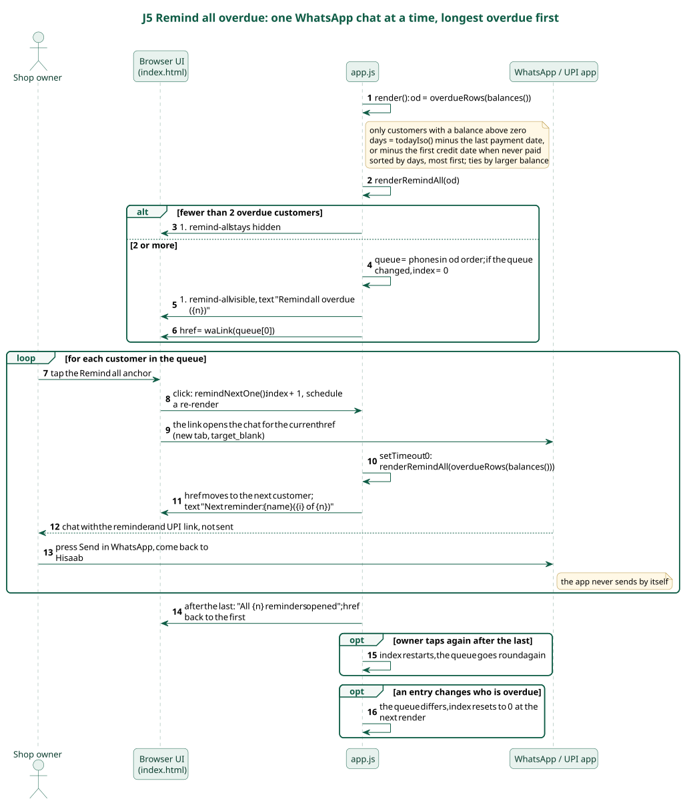
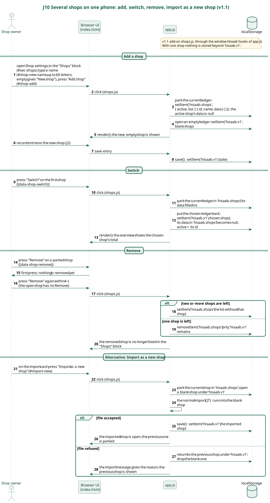
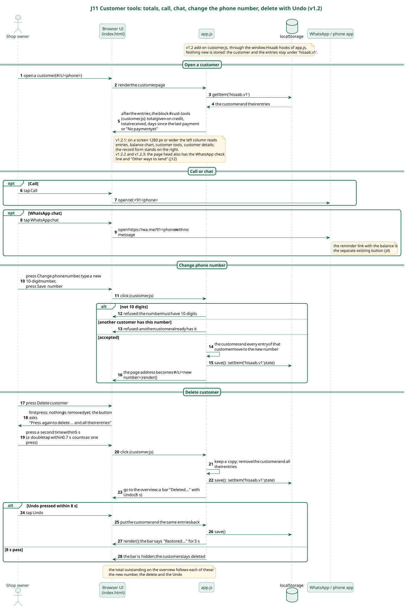
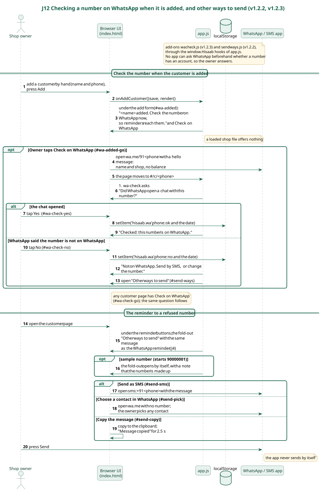

# Hisaab: user journeys

This page walks through what the shop owner does with Hisaab and what the app does in reply. Each journey
is drawn from `app.js`, `index.html` and `sw.js` as built, with the add-ons `profile.js`, `shops.js`,
`langs.js`, `extras.js`, `customer.js`, `names.js`, `sendways.js`, `wacheck.js`, `assist.js`, `guard.js` and `compact.js`, the layout sheets
`polish.css`, `brand.css` and `compact.css`, and the customer's pay page `pay.html`, at version 1.4.0.0: the function names, the order of calls, what is
read from and written to `localStorage`, and the links that open. Nothing here is planned work.

Every diagram is a PlantUML sequence diagram rendered to SVG. Participants appear in the same order in
each one: Shop owner, Browser UI (`index.html`), `app.js`, `localStorage`, Service worker (`sw.js`), the
library loaded from a CDN, WhatsApp or a UPI app, and the pay page (`pay.html`). A diagram shows only the
participants it uses.

To render again, from the project folder:

```
java -jar plantuml.jar -tsvg -charset UTF-8 docs/diagrams/j*.puml
```

Epics: E1 Customers and entries, E2 Shop overview, E3 Reminders and getting paid, E4 Customer page and
statement, E5 Quick entry, E6 Shop data, E7 Languages, themes and layout, E8 Navigation, offline and the
grader contract.

## The journeys

| ID | Name | Who | Trigger | Outcome | Epics |
| --- | --- | --- | --- | --- | --- |
| J1 | First open | Shop owner (or a tester) | Opens the app, optionally with `?today=` | Overview with the total outstanding and every balance; on a first visit an empty shop with two buttons, Add your first customer and Load sample shop | E2, E6, E7, E8 |
| J2 | Record an entry | Shop owner | Fills the entry form and presses Save, or taps Edit or Delete | Entry saved, changed or removed; balances re-rendered; Undo after an edit or a delete | E1, E3 |
| J3 | Quick entry by voice or typing | Shop owner | Taps the mic or types "Sunita 500 udhaar" | Entry form filled and Save focused; the owner saves | E5, E1, E7 |
| J4 | WhatsApp reminder | Shop owner, then the customer | Taps the WhatsApp button on a customer row | WhatsApp opens with the name, the balance, an https pay link to the pay page and the UPI link; the owner presses Send; the customer taps the pay link and their UPI app opens | E3 |
| J5 | Remind all overdue | Shop owner | Taps "Remind all overdue" | One chat per overdue customer, longest overdue first | E3, E2 |
| J6 | UPI QR and statement | Shop owner, then the customer | Opens a customer page, taps UPI QR code or Statement | QR drawn in the page; statement printed or saved as PDF with a scan-to-pay QR | E4, E3 |
| J7 | Load a shop file and export | Shop owner (or a tester) | Pastes a shop file or a CSV into `#import-box` and presses `#import-go`, or taps an export button | Shop replaced after checks, with Undo; CSV or JSON file downloaded | E6, E8 |
| J8 | Payment screenshot | Shop owner | Chooses a screenshot in the entry form | Picture shrunk and kept on the entry; amount read and offered for checking | E1, E3, E8 |
| J9 | Language and offline | Shop owner | Picks a language; later opens the app with no signal | Labels in one of twelve languages (three built in, nine fetched when chosen), kept after reload; the app opens offline with the same shop | E7, E8 |
| J10 | Several shops (added in 1.1.0.0) | Shop owner | In Shop settings types a name and presses "Add shop", presses "Switch" or "Remove", or presses "Import as a new shop" on the import card | More than one shop on the same phone; the shop in use stays under `hisaab.v1`, the others are parked under `hisaab.shops` | E6 |
| J11 | Customer tools (added in 1.2.0.0) | Shop owner | Opens a customer page and presses Call, WhatsApp chat, the change of phone number or Delete customer | Totals and days since the last payment shown; the phone app or a WhatsApp chat opens; the customer and their entries move to a new number, or are deleted with Undo for eight seconds | E4, E1 |
| J12 | Reaching a customer WhatsApp refuses, and checking a number when it is added (added in 1.2.2.0 and 1.2.3.0) | Shop owner | Adds a customer by hand and taps Check on WhatsApp, or opens "Other ways to send" on a customer page | The owner's answer (on WhatsApp or not) kept per number under `hisaab.wa`; the reminder sent as an SMS, to a contact chosen in WhatsApp, or copied | E3, E4 |

All twelve journeys are supported by the code. The first nine were asked for in the brief; none was dropped or merged. J10 was added in version 1.1.0.0, J11 in version 1.2.0.0 and J12 in versions 1.2.2.0 and 1.2.3.0.

## J1 First open

**Goal.** See at a glance how much the shop is owed in total and by whom; on a first visit, start a new
ledger or look around the sample shop.

**Preconditions.** A browser with `localStorage`. The service worker only registers over https or on
localhost.

**Steps.**
1. The head script in `index.html` reads `hisaab.theme` and sets light or dark before anything draws.
2. `sample.js` sets `window.HISAAB_SAMPLE` (used only as the fallback for Load sample shop); `app.js` reads
   `hisaab.lang` (English when missing or not built in). The add-ons follow: `profile.js`, `shops.js`,
   `langs.js`, `extras.js`, `customer.js`, `names.js`, `sendways.js`, `wacheck.js`, `assist.js`, `guard.js`, `compact.js`. `langs.js` adds nine
   languages to the menu `#lang` (twelve in all) and, when one of them was chosen before, fetches its file
   from `i18n/` and switches to it. `names.js`, `sendways.js` and `wacheck.js` draw only on a customer page
   (J9, J11, J12). The stylesheet `polish.css` loads last and changes the layout only.
3. `init()` calls `load()`, which reads `hisaab.v1`. A saved shop is used as it is.
4. On a first visit, or when the saved data cannot be read, `blank()` gives an empty shop ("My shop", no
   customers, no entries) and it is saved. The sample is not loaded: the brief's "Done when" lines add
   Ravi Kumar 9000000101 to a fresh app and expect Rs 250 after a Rs 250 credit.
5. `applyLabels()` sets the language; `resetEntryForm()` sets the date and the latest allowed date to
   `todayIso()`, which uses `?today=` when it is a valid date.
6. `route()` reads the address (`#/`, `#/s/{section}` or `#/c/{phone}`) and calls `render()`.
7. `render()` works out every balance (all credit minus all payments) and the total outstanding (the sum
   of all balances), then fills `#total-outstanding` (with `data-value` and a plain number copy), one `li[data-customer]` per customer with `span[data-balance]` and `a[data-remind]`, the
   top defaulter, the overdue list, the KPI tiles, the recent entries and the customer list in the form.
   With no customers it shows "No customers yet. Add your first customer, or load the sample shop to look
   around." and two buttons: `#add-first` opens `#/s/add` and focuses the name field, and
   `#load-sample-home` does the same as Load sample shop on the Shop file card (J7).
   The add-ons then draw on each render: `extras.js` puts the date the figures are for (`#as-of`) under the
   total and a line with the total unpaid for 30 days or more (`#overdue-total`, hidden when nobody is
   overdue); `shops.js` adds the Shops block (`#sec-shops`) at the end of the Shop settings card;
   `profile.js` adds the owner and address fields to Shop settings and a logo beside the shop name in the
   header (`#shop-logo-img`, hidden until a logo is set).
8. After the page's load event, `sw.js` is registered; it takes control at once (`skipWaiting`,
   `clients.claim`).


Source: [j1-first-open.puml](diagrams/j1-first-open.puml)

**Error and edge paths.**
- An invalid `?today=` value is ignored and the device date is used.
- If another tab changes `hisaab.v1`, the `storage` event reloads the state and renders again.
- When some customers are in advance, `#total-outstanding` still holds one figure (the sum of all
  balances); the note `#total-note` just below it, outside it, gives the amount owed and the advance, and
  those rows show an "Advance" label with the balance drawn as -₹200 (text ₹-200).

## J2 Record a credit or payment; edit and delete

**Goal.** Record a sale on credit or a payment in seconds, and correct mistakes safely.

**Preconditions.** At least one customer. A new customer can be added first with the Add customer form.

**Steps.**
1. Optional: the owner adds a customer. `onAddCustomer()` needs a name and a phone of only digits,
   spaces and + ( ) - . that is 10 digits after `phone10()` strips `+91` or a leading `0` (`validPhone()`)
   and that no other customer has; it saves, renders and selects the new customer in the entry form.
2. The owner picks the customer (on a customer page it is fixed), Credit or Payment, the amount, the date
   and a note, and presses Save entry. Since 1.2.0.0 six note shortcuts sit under the note field
   (`#note-chips`, from `extras.js`): groceries, milk, rice, oil, paid on UPI and cash, in the chosen
   language. A tap fills the note.
3. `onEntrySubmit()` checks, in this order: a customer is chosen, the amount is above zero, the amount is
   at most ₹1,00,00,000, the date is valid, the date is not after today.
4. A new entry is pushed with an id and a sequence number; an edited entry is first copied
   (`lastEdited`), then changed in place.
5. `save()` writes the whole shop to `hisaab.v1`; the form resets (the customer stays); `render()` redraws
   every figure.
6. A toast says "Saved." with a "Send receipt" link: a `wa.me` message with the amount, the date and the
   new balance. The owner presses Send in WhatsApp; the app never sends by itself.
7. Edit: the Edit button calls `startEdit()`, which fills the form and turns Save into Update; Cancel
   clears the form. After Update the toast says "Entry updated." with Undo and the "Send receipt" link for
   7 seconds; Undo puts the old entry back in place.
8. Delete: the Delete button calls `deleteEntry()` straight away (no confirm dialog), saves, renders and
   shows "Entry deleted." with Undo for 7 seconds. Undo puts the entry back where it was.



Source: [j2-record-entry.puml](diagrams/j2-record-entry.puml)

**Error and edge paths.**
- Each failed check shows its message in `#entry-msg` and focuses the field; nothing is saved.
- Add customer with a phone that has letters or other symbols, or is not 10 digits after clean-up:
  "Enter a 10 digit phone number, digits only." and nothing is saved.
- Add customer with a 10 digit number that does not start with 6, 7, 8 or 9: the customer is added and
  "Customer added." is followed by "Check the number: Indian mobile numbers start with 6, 7, 8 or 9, so
  WhatsApp may not reach this one." (`validMobile()`). Loading a shop file (J7) accepts any 10 digits
  with no warning.
- If `localStorage` is full, a toast says "Storage is full. Export a backup, then remove some screenshots."
- Saving a new entry has no Undo; Undo is offered after an edit, after a delete and after loading a shop
  (J7). After 7 seconds the toast closes and the change can no longer be undone; a delete or an import
  also clears the Undo of an edit.

## J3 Quick entry by voice or typing

**Goal.** Say or type one short phrase, such as "Sunita 500 udhaar", and have the form filled.

**Preconditions.** The mic button shows only when the browser has `SpeechRecognition` or
`webkitSpeechRecognition`; typing always works.

**Steps.**
1. The owner taps the mic. `app.js` starts recognition in `hi-IN`, `te-IN` or `en-IN` to match the app
   language, and shows "Listening...".
2. The words heard are written into `#quick-input` as they come. When recognition ends with words heard,
   `onQuick()` runs. Typing a phrase and pressing Fill (or Enter) runs `onQuick()` the same way.
3. `parseQuick()` reads the phrase: Hindi and Telugu digits become 0 to 9; ₹, Rs and commas are dropped;
   the first number is the amount, and hazaar, sau, lakh, thousand or hundred after it multiply it; a
   payment word (paid, jama, mila, UPI, GPay) makes it a payment, a credit word (udhaar, diya, baki) a
   credit; the remaining words are scored against each customer's name in English, Hindi and Telugu
   script, and against the phone or its last four digits; leftover words become the note.
4. `applyQuick()` fills the customer, type, amount, date (if empty) and note, says "Filled: ... Check it,
   then press Save entry." and moves the focus to Save entry. Nothing is saved yet.
5. The owner checks the form and presses Save entry, which follows J2.



Source: [j3-quick-entry-voice.puml](diagrams/j3-quick-entry-voice.puml)

**Error and edge paths.**
- Several customers tie: "More than one customer matches. Pick one:" with up to six buttons; tapping one
  fills the form.
- No customer matches: "Which customer? Say the name...".
- A customer but no amount: the customer is selected, "Say or type an amount..." is shown and Amount gets
  the focus.
- No type word: the entry is taken as credit, and the message says so.
- On a customer page the customer is already known, so only the amount, type and note are read.
- Recognition errors say why: "Did not catch that..." (no speech), "The microphone is blocked for this
  site..." (not allowed), "No microphone was found..." (no microphone), "This browser's speech service did
  not answer..." (network), or "Could not use the microphone..." (anything else). A language the service
  refuses is tried once more in `en-IN`.
- Since 1.2.5.0 (`assist.js`), when a typed quick entry finds no customer and the text held a name, the
  question "Which customer?" stays and `#quick-choices` shows 'No customer matches "Sunita".' with the button
  `#quick-add-customer`. The button opens Add a customer (`#/s/add`) with `#customer-name` filled and the cursor
  on `#customer-phone`. The same add-on says which theme is on after `#theme-toggle` is pressed, names the
  view after a press on a navigation item, and puts the focus on `#main` from the skip link.
- Since 1.2.4.0 voice never ends in silence: when the service stops with no result and no error, the app
  says "Did not catch that. Try again or type it." A service that gives nothing for 9 seconds is stopped,
  with "This browser's speech service did not answer...".
- Since 1.2.4.0 every voice failure line is followed by a tip. On a phone or tablet (its user agent names
  Android, iPhone, iPad or iPod) the tip is the microphone key of the keyboard (`quickKeyTip`). On anything
  else it is the computer's own dictation, the Windows key and H (`quickPcTip`), so a laptop with a touch
  screen gets the laptop tip.
- Amounts must be said or typed as digits; number words such as "paanch" are not read.
- In the nine languages fetched by `langs.js`, that language's words for credit and payment are taught to
  the parser (`H.quickWords`) when the language loads.

## J4 WhatsApp reminder

**Goal.** Ask a customer to pay in one tap, with the right amount and a way to pay.

**Preconditions.** The customer has a 10 digit Indian number. The shop's UPI ID is set in Shop settings;
until then the demo ID `hisaab.demo@upi` is used and Settings says so. Settings checks the UPI ID with
`validUpi()` (`name@handle`, for example `shopname@okbank`); a bad ID shows "Enter a UPI ID like
shopname@okbank, or leave it empty." and nothing is saved. Empty is allowed.

**Steps.**
1. At every render, each row's `a[data-remind]` gets its link: `https://wa.me/91{phone}?text=` and the
   message from `reminderText()`.
2. When the customer owes money, the message reads, line by line: "Namaste {name}, this is a reminder
   from {shop}. Your balance is Rs {amt}.", a blank line, "UPI pay link:" and an https link built by
   `payPage()`, a blank line, "Pay by UPI:" and the link built by `upiLink()`, a blank line, "Thank you."
   - The https link points at `pay.html` on the app's own address:
     `pay.html#pn={shop}&tn=Hisaab {name}&pa={UPI ID}&am={balance, two decimals}`. WhatsApp makes only
     https addresses tappable, so this is the link the customer taps.
   - The UPI link is as before:
     `upi://pay?pa={UPI ID}&am={balance, two decimals}&pn={shop}&cu=INR&tn=Hisaab {name}`.
3. The owner taps the WhatsApp button. It is a plain link; WhatsApp (or WhatsApp Web) opens the chat with
   the message typed in.
4. The owner presses Send in WhatsApp. The app never sends by itself.
5. The customer taps the "UPI pay link". `pay.html` opens in the customer's browser and reads the details
   after "#" in the page itself. A browser never sends that part to a server, and the page stores and sends
   nothing. It shows the shop, the amount and the UPI ID, a button "Open your UPI app" with the
   `upi://pay` link, and a Copy button for the UPI ID. On a phone it opens the UPI app by itself after
   0.4 seconds; the button stays for a second try. On a computer the customer copies the UPI ID.
6. The customer pays in their UPI app; the owner then records the payment (J2).


Source: [j4-whatsapp-reminder.puml](diagrams/j4-whatsapp-reminder.puml)

**Error and edge paths.**
- A customer in advance gets a message stating the advance; a settled customer gets "Your account is
  settled, Rs 0 due."; neither contains a pay link.
- A pay link that is broken or cut short (a UPI ID not like `name@handle`, or an amount that is not above
  zero and below 100,000,000) shows "This payment link is not complete. Ask the shop to send it again."
- When the app is opened from a file rather than over http or https, `payPage()` gives nothing and the
  message carries only the `upi://pay` link, as before 1.2.1.0.
- When WhatsApp refuses the number, the customer page offers other ways to send the same message (J12).
- Changing the shop name or UPI ID in Settings rebuilds every link at the next render.
- The customer page has the same reminder (`#cust-remind`) and a UPI pay link button (`#cust-upi`, shown
  only when money is owed).
- The message follows the app language.

## J5 Remind all overdue

**Goal.** Work through everyone who owes money, longest overdue first, without searching for each.

**Preconditions.** At least two customers with a balance above zero; with fewer the button stays hidden.

**Steps.**
1. `overdueRows()` lists customers who owe money, with the days since their last payment (or since their
   first credit when they never paid), counted to `todayIso()`; most days first, then the larger balance.
2. `renderRemindAll()` keeps a queue of their phones, labels the button "Remind all overdue (n)" and
   points its link at the first customer's `wa.me` reminder.
3. The owner taps the button. The click handler `remindNextOne()` moves the queue on by one, the link
   opens the current chat in a new tab, and straight after (`setTimeout` 0) the button's link moves to the
   next customer and reads "Next reminder: {name} (i of n)".
4. In each chat the owner presses Send in WhatsApp, then comes back and taps again.
5. After the last one the button reads "All n reminders opened".



Source: [j5-remind-all.puml](diagrams/j5-remind-all.puml)

**Error and edge paths.**
- Tapping after the last reminder starts the queue again from the top.
- If an entry changes who is overdue, the queue is rebuilt and starts again at the first customer.
- The app opens chats only; nothing is sent without the owner.
- Since 1.2.0.0 `extras.js` adds one line by the overdue list (`#overdue-total`): the amount unpaid for 30
  days or more and from how many customers. It also adds `#as-of` under the total, the date the figures
  are for.

## J6 UPI QR code and statement

**Goal.** Let a customer at the counter scan to pay, and give a customer a printed or PDF statement.

**Preconditions.** A customer page is open (`#/c/{phone}`). The QR button shows only when the customer
owes money. The QR library needs a network connection the first time.

**Steps.**
1. Tapping a customer opens `#/c/{phone}`; `route()` shows the customer page and `renderCustomer()` fills
   the name, phone, balance, last payment and the entries with the running balance after each. Since
   1.2.0.0 `profile.js` also draws a "Balance over time" line as inline SVG, with the highest and lowest
   balance.
2. UPI QR code: `showQr()` opens the card with the amount and UPI ID. `loadQr()` adds
   `qrcode-generator` 1.4.4 from cdnjs the first time, then `qrSvg()` draws the `upi://pay` link as an SVG
   QR code in the page. Tapping again closes it.
3. Statement (PDF): the app waits for the QR library for at most 1.5 seconds, then `printStatement()`
   builds the statement (shop, customer, date, entries oldest first with gave, got and balance, totals),
   adds a scan-to-pay QR when money is owed and the library is loaded, and calls `window.print()`.
   Before printing, `profile.js` puts the shop logo and a line with the owner name and address in the
   statement head when the shop profile has them. The same logo shows in the top bar.
4. The browser's print dialog lets the owner print or save as PDF; afterwards the page returns to normal.


Source: [j6-qr-and-statement.puml](diagrams/j6-qr-and-statement.puml)

**Error and edge paths.**
- If the library cannot load (offline or blocked), the card shows the `upi://pay` link as text, and the
  next tap tries to load it again.
- If the library is not ready within 1.5 seconds, the statement prints without the QR code.
- A customer with nothing owed has no QR button and no QR on the statement.

## J7 Load a shop file and export

**Goal.** Replace the shop with another shop file or a spreadsheet, safely, and take the data out as CSV
or JSON.

**Preconditions.** For loading, a shop file in JSON with `customers` and `entries` lists, or a spreadsheet
saved as CSV or tab-separated text with a phone column and at least one of amount, credit, payment or
name.

**Steps.**
1. The owner pastes the file into `#import-box` and presses `#import-go` (Load). Choosing a `.json`,
   `.csv` or `.txt` file, or "Load sample", puts the text in the same box and loads it the same way.
2. `doImport()` reads text that starts with `{` or `[` as JSON and anything else as CSV: `csvRows()` and
   `fromCsv()` match the headers by meaning (see [Importing a CSV](schema/export-entries.csv.md#importing-a-csv))
   and turn the rows into a shop object, keeping the current shop name.
3. `fromShopFile()` checks it: phones cut to 10 digits, duplicates dropped, Hindi words for credit and
   payment accepted, amounts with Rs or commas cleaned, an amount that is missing, blank, not a number,
   negative or above 10,000,000 skipped, dates as YYYY-MM-DD or DD/MM/YYYY, a missing or unreadable date
   set to today and counted, a bad UPI ID in the file skipped (the current one is kept), customers created
   from entries when missing, bad rows skipped.
4. The current shop is kept as a snapshot, the new shop replaces it (no merge), is saved to `hisaab.v1`,
   and the overview is rendered.
5. The message gives the shop name and the counts of customers and entries, then "{n} entries had no date
   and are dated today." when any were, then "Skipped {n}: " with the first three skipped rows (translated
   in English, Hindi and Telugu); a toast "Shop loaded." offers Undo for 7 seconds, which restores the
   snapshot.
6. Export: Entries CSV, Balances CSV (with a TOTAL OUTSTANDING row) or the shop file as JSON, each
   downloaded through a Blob link named after the shop.


Source: [j7-import-export.puml](diagrams/j7-import-export.puml)

**Error and edge paths.**
- An empty box or a file without the two lists: "The file needs customers and entries lists."; invalid
  JSON: "This is not valid JSON: " and the parser's message; a CSV without a phone column, or with no
  amount, credit, payment or name column: "Paste a shop file (JSON) or a spreadsheet saved as CSV with
  name, phone, type, amount and date columns." Nothing is replaced.
- Amount 0 and future dates are accepted on import; impossible dates such as 2026-02-30 are kept.
- A file in which no customer is valid is refused with the first three problems listed; a file with some
  bad rows loads and lists what was skipped.
- There is no confirm dialog; Undo is the safety net.
- CSV cells that start with `=`, `+`, `-` or `@` get a leading quote so a spreadsheet does not run them.
- The JSON export leaves out screenshots. It carries the shop profile (owner, address, logo), and a file
  with a profile brings it back on import (`profile.js`).
- The Entries CSV loads back through the same box to the same totals.

## J8 Payment screenshot

**Goal.** Keep the customer's payment screenshot on the entry, and save typing by reading the amount
from it.

**Preconditions.** The entry form is open. Reading the amount needs a network connection to load
Tesseract.js.

**Steps.**
1. The owner chooses a picture in `#shot-input`. `onShotChange()` sets the type to Payment.
2. The picture is drawn on a canvas at most 600 px on its longest side (640 px until 1.2.6.0), on white, and kept as a JPEG at
   quality 0.72; a preview shows.
3. `readAmount()` loads Tesseract.js 5.1.1 the first time and reads the original picture with a worker:
   `eng+hin` for Hindi, `eng+tel` for Telugu, `eng` for English and the other nine languages, falling back
   to `eng` if the combined language fails to load. It reads the picture as scattered text first and, if
   that finds no amount, once more as one block.
4. `qNorm()` turns Devanagari and Telugu digits into 0 to 9. `pickAmount()` prefers the largest number after ₹, Rs,
   INR, "amount", "paid", रु, रुपये, राशि, రూ, మొత్తం or భుగతాన, otherwise the largest plain number
   that is not a year. A Hindi screenshot reading "भुगतान रु ४५०" fills 450. The amount goes into the Amount field only if the field is empty or was filled by
   the reader, with "Read Rs {amt} from the screenshot. Check it before saving."
5. The owner checks the amount and presses Save entry (J2). The small JPEG is stored on the entry inside
   `hisaab.v1`, and the entry shows it as `img[data-shot]`.


Source: [j8-payment-screenshot.puml](diagrams/j8-payment-screenshot.puml)

**Error and edge paths.**
- A file that is not a picture: "That file is not a picture."
- No amount found, or the library cannot load: "Could not read an amount from this picture. Type it in."
- Once the owner types in Amount, the reader no longer overwrites it.
- Remove picture clears it; on Update the picture is removed from the entry. Editing without a new
  picture keeps the old one.
- Pictures fill `localStorage` fastest; when it is full, the app says to export a backup and remove some
  screenshots.
- Unlike the QR library, Tesseract.js is loaded from jsDelivr (`cdn.jsdelivr.net`), not from cdnjs.
- Tesseract.js downloads its language data on first use; neither is cached for offline.

## J9 Language and offline

**Goal.** Use the app in English, Hindi or Telugu, or since 1.2.0.0 in Bengali, Marathi, Tamil, Gujarati, Kannada, Malayalam, Punjabi, Odia or Urdu, and keep working in a shop with no signal.

**Preconditions.** For offline use the app has been opened online over https (or on localhost) once, so
the service worker has installed and cached the app shell.

**Steps.**
1. The owner picks one of the twelve languages in `#lang`. English, हिंदी and తెలుగు are built into
   `app.js`; the other nine are fetched by `langs.js` from `i18n/{code}.json` when chosen. The choice is saved as `hisaab.lang`; `applyLabels()`
   changes every label and placeholder and `render()` redraws: names with the local script in brackets,
   dates in the chosen locale, reminders and receipts in the chosen language. Since 1.2.1.0 the name in
   brackets is in the script of every language but English: Hindi and Telugu from `app.js`, the other nine
   from the add-on `names.js` through the hook `Hisaab.nameIn`.
2. Optional: Hindi or Telugu digits (`#native-digits`, saved in the shop) and the light or dark theme
   (`hisaab.theme`).
3. On install `sw.js` precaches the app shell (`./`, `index.html`, `styles.css`, `app.js`, the add-ons
   `profile`, `shops`, `extras` and `customer` as `.css` and `.js`, `langs.js`, `names.js`, `sendways.js`,
   `wacheck.js`, `polish.css`, `pay.html`, `sample.js`, `sample-data.json`, `icon.svg`,
   `manifest.webmanifest`) in the `hisaab-v10` cache; on activate it deletes older caches.
4. While online, `sw.js` answers each GET to the app's own origin, to `qrcode-generator` on cdnjs and to
   Google Fonts from the network first and keeps a copy in `hisaab-v10`.
5. With no signal the network request fails and `sw.js` returns the cached copy (ignoring the query, so
   `?today=` still works), or `index.html`.
6. `init()` reads the same language and the same shop from `localStorage`, so the owner carries on.


Source: [j9-language-offline.puml](diagrams/j9-language-offline.puml)

**Error and edge paths.**
- The service worker registers after the first page load and precaches the shell when it installs, so
  one online visit is enough: offline, the ledger opens with the same totals. The QR code draws offline
  once the QR library has loaded online and been cached.
- Tesseract.js (jsDelivr) is not cached by `sw.js`; offline, the screenshot reader says it could not read
  an amount. If the QR library was never loaded online, the QR card shows the pay link as text.
- An unknown saved language falls back to English.

## J10 Several shops (added in 1.1.0.0)

**Goal.** Keep more than one shop on the same phone and move between them.

**Preconditions.** The app is open. With one shop nothing is stored beyond `hisaab.v1`.

**Steps.**
1. The owner opens Shop settings, types a name in the "Shops" block (up to 60 letters; empty gives "New
   shop") and presses "Add shop".
2. The app parks the current ledger in `hisaab.shops` and opens an empty ledger under `hisaab.v1`.
3. The owner records entries in the new shop (J2).
4. The owner presses "Switch" on the first shop: the current ledger is parked, the chosen one is put back
   under `hisaab.v1`, and the overview shows its total.
5. "Remove" on a parked shop needs a second press within four seconds. The open shop has no Remove.



Source: [j10-several-shops.puml](diagrams/j10-several-shops.puml)

**Error and edge paths.**
- "Import as a new shop" on the import card parks the current shop, opens a blank one and runs the normal
  import (J7) into it. If the file is refused, the app returns to the previous shop and drops the blank one.
- `hisaab.shops` = `{ active, list: [ { id, name, data } ] }`; the active shop's `data` is null because its
  ledger lives under `hisaab.v1`. The key is not written until a second shop is added and is removed again
  when one shop is left.

## J11 Customer tools (added in 1.2.0.0)

**Goal.** See a customer's totals at a glance, call or message them, correct a wrong phone number, or remove a
customer who should not be in the ledger.

**Preconditions.** A customer page is open. The block "More for this customer" sits after the entries.
Since 1.2.1.0 (`polish.css`), on a screen 1280 px or wider the page reads down one column (entries, the
balance chart, this block, the customer details) with the record form beside it; entries stack in a
narrow card, and the heading keeps its width while its buttons wrap. Since 1.2.2.0 and 1.2.3.0 the page
head also has the WhatsApp check line and the fold-out "Other ways to send" (J12).

**Steps.**
1. The owner opens a customer and reads the total given on credit, the total received, and the days since the
   last payment (or "No payment yet").
2. "Call" opens the phone app with the customer's number; "WhatsApp chat" opens a chat with no message. The
   reminder with the name and the balance is the separate button of J4.
3. To change the number the owner types a new 10-digit number and saves. The customer and every entry of that
   customer move to the new number, and the page address follows.
4. To delete, the owner presses "Delete customer", then presses again within five seconds. The customer and
   all their entries are removed, the overview opens, and a bar says who was deleted, with Undo for eight
   seconds.



Source: [j11-customer-tools.puml](diagrams/j11-customer-tools.puml)

**Error and edge paths.**
- A number that is not 10 digits, or that another customer already has, is refused with a message.
- Two taps in quick succession on Delete count as one press.
- Undo puts the customer and the same entries back, and the bar says "Restored {name}." for three
  seconds. After the eight seconds, a reload or a switch to another
  shop, the deletion stands.
- The ledger's own Undo (for an entry or an import) is cleared by a phone change or a delete, so it cannot put an
  entry back under the old number.
- The total outstanding on the overview follows each change.

## J12 Reaching a customer WhatsApp refuses, and checking a number when it is added (added in 1.2.2.0 and 1.2.3.0)

**Goal.** Know before the first reminder whether a customer's number is on WhatsApp, and still reach a
customer whose number WhatsApp refuses.

**Preconditions.** A customer is added by hand, or a customer page is open. No app can ask WhatsApp
beforehand whether a number has an account. WhatsApp refuses such a number inside its own app, where
Hisaab cannot help. So the owner opens a chat and says what happened.

**Steps.**
1. The owner adds a customer by hand (J2). The add-customer card then shows "{name} added. Check the
   number on WhatsApp now, so reminders reach them." with the button Check on WhatsApp (`#wa-added-go`).
2. The button is a `wa.me` link to the number with a hello message: the customer's name and the shop, no
   balance. WhatsApp opens in its own tab or app, and Hisaab moves to that customer's page.
3. There `#wa-check` asks "Did WhatsApp open a chat with this number?" with Yes (`#wa-check-yes`) and No
   (`#wa-check-no`).
4. The answer is kept per number, with the date, under the browser key `hisaab.wa`, outside the ledger.
   The line then reads "Checked: this number is on WhatsApp." or "Not on WhatsApp. Send by SMS, or change
   the number." No also opens "Other ways to send".
5. Any customer page has Check on WhatsApp (`#wa-check-go`), which opens the same hello message and asks
   the same question. Until it is answered the line reads "This number has not been checked on WhatsApp
   yet."
6. Under the reminder buttons on the customer page, the fold-out "Other ways to send" (`#send-ways`) holds
   the same message as the WhatsApp reminder (J4), in three ways:
   - Send as SMS (`#send-sms`): an `sms:` link to the customer's number with the message.
   - Choose a contact in WhatsApp (`#send-pick`): a `wa.me` link with no number, so the owner picks any
     contact, such as a family member.
   - Copy the message (`#send-copy`): copies it and says "Message copied" for 2.5 seconds.
7. The owner presses Send in the SMS app or in WhatsApp. The app never sends by itself.



Source: [j12-whatsapp-check-and-other-ways.puml](diagrams/j12-whatsapp-check-and-other-ways.puml)

**Error and edge paths.**
- Loading a shop file offers no check: its customers count as known, not as just added.
- The add-card offer shows only when one customer was added and the number has no answer yet.
- For a sample number of the sample shop (one that starts 90000001, such as 9000000102), the fold-out
  opens by itself with a note that the number is made up and should first be changed to the owner's own.
- When the browser store is full, the answer is simply not remembered; the ledger is not touched.
- None of these links carries `data-remind`, so the count of reminder links is unchanged.
- The owner's answer is a record of what WhatsApp showed, not a check made by Hisaab.
- A wrong answer is put right with one tap (since 1.2.3.1): once a number has an answer, a button beside Check on
  WhatsApp (`#wa-check-flip`) offers the other answer and switches it without opening WhatsApp again.

## Versions 1.2.6.0 to 1.4.0.0 (27 Nov 2026): what changed in the journeys

- **J1 on a phone (1.4.0.0, `compact.js`):** below phone width the top bar is 56 px, the total is compact, quick
  entry is one pill at the bottom and a slim tab row sits above it. Every other action (add a customer, an entry,
  import, export, settings) is in the + sheet, opened by tap, Enter or Space and closed by Escape or a tap outside.
  With the sample shop, 4 customer rows are fully on the first screen at 375 x 667. The desktop is unchanged.
- **J1 on first open (1.2.6.0, `guard.js`):** when the browser blocks storage, a lasting notice says nothing can
  be kept in this mode and points to a normal window or a backup file. The sai4b mark is first in the top bar
  (1.3.0.0, `brand.css`); no green anywhere.
- **J2 and J3 (1.3.0.0):** an amount with paise is not saved; the form, or the edit, stays open with "Use Rs n",
  the nearest whole amount. An edit with the date cleared stays open and asks for the date (1.2.6.0). A change
  the store refused is said as not kept, and "Saved." is not left standing.
- **J7 (1.3.0.0):** an import rounds paise to whole rupees, halves up, and says how many; a picture that is not
  an image or is over 400,000 characters is left out and counted (1.2.6.0). Stored paise get one line that
  offers to round them, with Undo.
- **J8 (1.2.6.0):** the screenshot is kept at most 600 px on its longest side.
