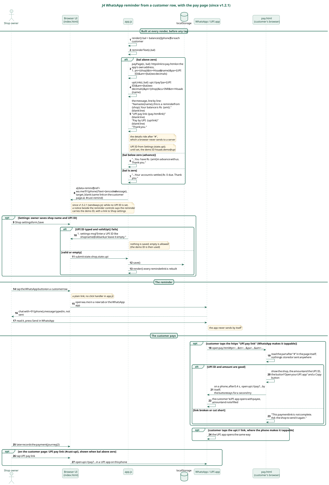
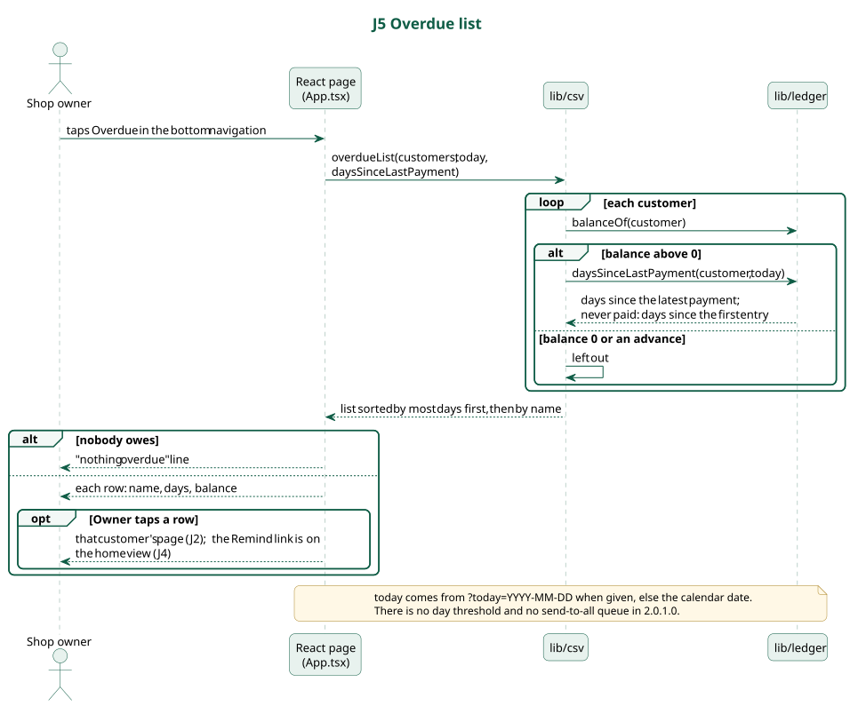
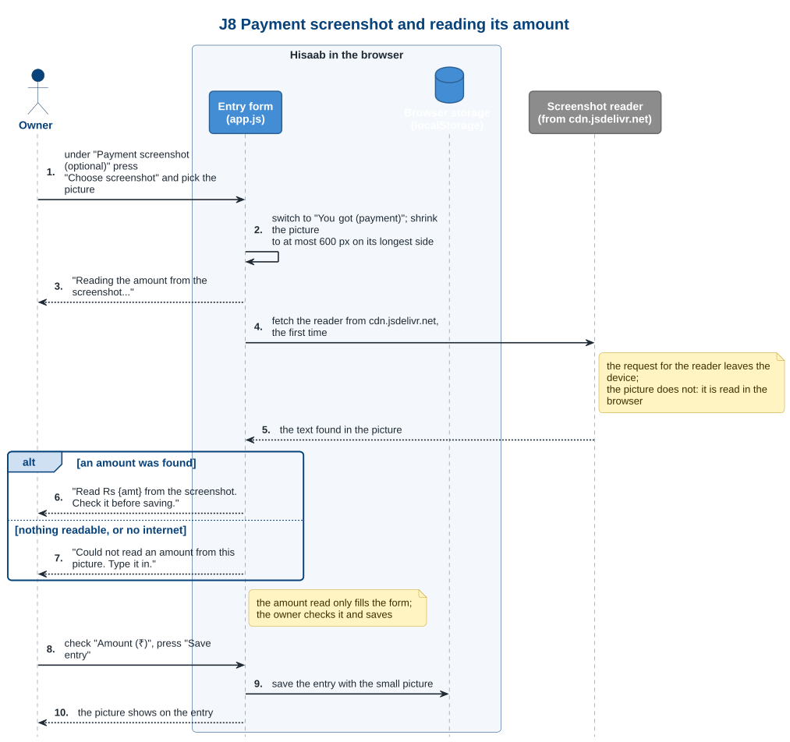
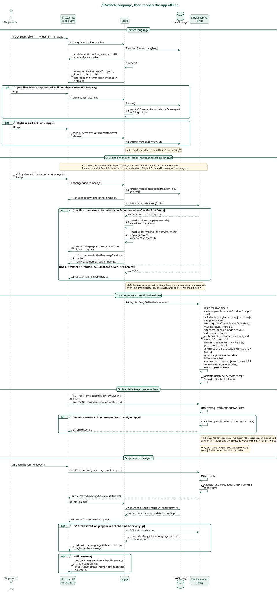

# Hisaab: user journeys

This page walks through what the shop owner does with Hisaab and what the app does in reply. Each journey
is drawn from the code of version 2.0.1.0 as built: `src/App.tsx`, `src/components/`, `src/hooks/`,
`src/store/useShopStore.ts`, `src/lib/` and `public/sw.js`: the function names, the order of calls, what is
read from and written to `localStorage`, and the links that open. Nothing here is planned work.

Every diagram is a PlantUML sequence diagram rendered to SVG. To render again, from the project folder:

```
java -jar plantuml.jar -tsvg -charset UTF-8 docs/diagrams/j*.puml
```

## The journeys

| ID | Name | Who | Trigger | Outcome |
| --- | --- | --- | --- | --- |
| J1 | First open | Shop owner (or a tester) | Opens the app, optionally with `?today=` | Home view with the total outstanding and every balance; a ledger saved by version 1 is carried over; an empty ledger otherwise |
| J2 | Record an entry | Shop owner | Adds a customer; fills the entry form and presses Save; taps Edit or Delete | Entry saved, changed or removed; balances recomputed; Undo after a delete |
| J4 | WhatsApp reminder | Shop owner, then the customer | Taps Remind on a customer row | WhatsApp opens with the name, the balance and, when money is owed, a `upi://pay` address; the owner presses Send |
| J5 | Overdue list | Shop owner | Taps Overdue in the bottom navigation | Every customer who owes, the longest without a payment first |
| J7 | Load a shop file and export | Shop owner (or a tester) | Pastes a shop file into `#import-box` and presses `#import-go`, or presses an export button | Ledger replaced after checks, or left untouched with an error; a CSV file downloaded |
| J8 | Payment screenshot | Shop owner | Chooses a picture in the entry form | Picture shrunk and kept on the entry |
| J9 | Language, theme and offline | Shop owner | Picks a language or the theme; later opens the app with no signal | Text in English, Hindi or Telugu, kept after reload; the app opens offline with the same ledger |

The numbers are those of version 1, kept so that references stay stable. J3 (quick entry by voice or typing),
J6 (UPI QR code and statement), J10 (several shops), J11 (customer tools) and J12 (other ways to send and the
WhatsApp check) described features that 2.0.1.0 does not have; they and their diagrams were removed. J5 was
"Remind all overdue" in version 1; 2.0.1.0 has the overdue list without the send-to-all queue.

## J1 First open


Source: [j1-first-open.puml](diagrams/j1-first-open.puml).

1. The owner opens the address. A tester may add `?today=YYYY-MM-DD`; `todayFromUrl()` uses it as today,
   otherwise the calendar date is used.
2. When the store module loads, `carryOverVersion1()` looks for `hisaab-shop-v2`. Only if it is absent and
   `hisaab.v1` holds a version 1 ledger, `legacyToV2()` converts it (a broken row is skipped, the shop's UPI id
   is kept) and it is written under `hisaab-shop-v2`. The old key is left as it was.
3. The store's `persist` reads `hisaab-shop-v2`. With nothing stored the ledger is empty: no sample data is
   loaded.
4. `useLang` reads `hisaab-lang`, else the version 1 key `hisaab.lang` when it is English, Hindi or Telugu,
   else English. `useTheme` reads `hisaab-theme`, else `hisaab.theme`, else follows the system.
5. The home view shows the total outstanding (`#total-outstanding`), the search box, the customers by highest
   balance (`[data-customer]`, `[data-balance]`, `[data-remind]`), the two CSV buttons, the Add customer form
   and the import box. An empty ledger shows one line saying so; a name typed into the search box of an empty
   ledger is offered as the first customer and prefilled in the form.
6. In a built site `main.tsx` registers `/sw.js` and posts it the addresses the page has loaded (see J9).

## J2 Record a credit or payment; edit and delete


Source: [j2-record-entry.puml](diagrams/j2-record-entry.puml).

1. **Add a customer.** Name and phone, Save. `addCustomer()` refuses an empty name (`errName`), a phone that
   is not exactly 10 digits (`errPhone`) and a phone already used (`errPhoneDup`); the message shows under the
   form and nothing is saved.
2. **Open the customer.** A tap on the row shows the customer's page: name, phone, balance, days since the
   last payment (or "never paid" with the days since the first entry), the entry form and the entries newest
   first (by date, then by id).
3. **Record an entry.** Type (credit by default, or payment), amount, date (today by default), note, an
   optional screenshot (J8), Save. `addEntry()` refuses an amount that is not a whole number above 0
   (`errAmount`) and a date that is not `YYYY-MM-DD` (`errDate`).
4. **The write.** Every change goes through `commit()`. If the browser's store is full the ledger is put back
   as it was and the owner sees the "storage full" message; nothing is shown as saved that a reload would lose.
5. **After a save** the form is cleared, the status line says the entry was saved, and the balance and the
   total are recomputed from the entries with `balanceOf()` and `totalOutstanding()`.
6. **Edit.** Edit on an entry turns the row into a form (type, amount, date, note); Save calls `updateEntry()`
   with the same checks. There is no Undo for an edit.
7. **Delete.** Delete removes the entry at once, with no confirmation window, and keeps it in memory as
   `lastDeleted`. The status line shows an Undo button (`[data-undo]`) with no time limit; `undoDelete()` puts
   the entry back. Only the last deleted entry can be restored; a reload or an import clears it.

## J4 WhatsApp reminder



Source: [j4-whatsapp-reminder.puml](diagrams/j4-whatsapp-reminder.puml). Link formats:
[schema/links.md](schema/links.md).

1. Every customer row on the home view carries a Remind link, built by `reminderHref()` when the row is drawn.
2. The text follows the language chosen in the header and the sign of the balance: owes, advance or zero. The
   figure is always written like `Rs 3,470`.
3. When the balance is above zero the text ends with ` Pay: upi://pay?pa=<id>&am=<balance>&cu=INR`. The id is
   the shop's UPI id from Settings, or the demo id `hisaab.demo@upi` until one is set (Settings says so).
4. The link is `https://wa.me/91<phone>?text=<encoded text>` and opens in a new tab. The owner presses Send in
   WhatsApp; Hisaab sends nothing itself and does not know whether the message went or was paid.
5. When the customer pays, the owner records the payment (J2).

## J5 Overdue list



Source: [j5-overdue-list.puml](diagrams/j5-overdue-list.puml).

1. The owner taps Overdue in the bottom navigation.
2. `overdueList()` keeps every customer whose balance is above zero and asks `daysSinceLastPayment()` for the
   days since the latest payment, or since the first entry for a customer who never paid.
3. The list is sorted by most days first, then by name. Each row shows the name, the days and the balance; a
   tap opens the customer's page. With nobody owing, one line says so.
4. There is no day threshold and no button that reminds everyone; a reminder is sent per customer (J4).

## J7 Load a shop file and export


Source: [j7-import-export.puml](diagrams/j7-import-export.puml). Formats:
[schema/shop-file.schema.json](schema/shop-file.schema.json),
[schema/export-entries.csv.md](schema/export-entries.csv.md).

1. The owner pastes JSON into `#import-box` and presses `#import-go`. Typing in the box clears an earlier error.
2. `importJson()` parses the text. Text that is not JSON gives "That is not valid JSON. Nothing was changed."
3. `validateImport()` checks every row and stops at the first that fails, naming it (for example
   "Entry 3: unknown phone 9876543210."): a customer needs a name and a 10-digit phone that is not repeated; an
   entry needs a known phone, the type `credit` or `payment`, a whole amount above zero and a date
   `YYYY-MM-DD`. A phone written as a number and an amount written as a digit string are accepted; a file
   with no `entries` loads as customers only. On any error the ledger is exactly as it was.
4. A file that passes replaces the whole ledger: shop name (or "Shop"), customers and entries, in the order of
   the file. The shop's UPI id is a setting and is kept. The Undo memory is cleared. There is no Undo for an
   import.
5. **Export.** Export balances downloads `hisaab-balances.csv`; Export entries downloads `hisaab-entries.csv`
   with a running balance per customer. Both buttons are on the home view and in Settings. The files are
   built in the browser and nothing is sent anywhere.

## J8 Payment screenshot



Source: [j8-payment-screenshot.puml](diagrams/j8-payment-screenshot.puml).

1. In the entry form the owner chooses a picture (`#shot-input`) and presses Save.
2. `resizeToDataUrl()` draws it on a canvas so that the longest side is at most 600 px (never enlarged), on a
   white background, and encodes it as JPEG at quality 0.75. While the result is above 150,000 characters the
   quality is lowered by 0.1, down to about 0.35.
3. A file that cannot be read as a picture gives a message and nothing is saved.
4. The data URL is saved with the entry as `shot`. If the store is full the save is refused (J2, step 4).
5. The entry shows a small picture (`[data-shot]`). The picture never leaves the browser. 2.0.1.0 does not
   read the amount from the picture.

## J9 Language, theme and offline



Source: [j9-language-offline.puml](diagrams/j9-language-offline.puml).

1. **Language.** The list in the header offers English, Hindi and Telugu. The choice is saved under
   `hisaab-lang`, sets the page's `lang` attribute and changes the labels, the messages and the reminder text.
   A key with no translation falls back to English.
2. **Theme.** The button in the header switches light and dark, saves the choice under `hisaab-theme` and the
   status line says which theme is on. Until the owner chooses, the theme follows the system.
3. **Online.** The service worker answers same-origin GET requests from the network first and stores a copy
   of each good response in the cache `hisaab-v20`.
4. **No signal.** The request fails and the stored copy is returned, matched by address (the query is ignored
   for a page); a page with no copy gets the stored `/`. The ledger, language and theme come from
   `localStorage`, and every change still saves.
5. **Coming from version 1.** The worker is served from the same address as the version 1 worker, takes over
   at once and deletes its caches.
