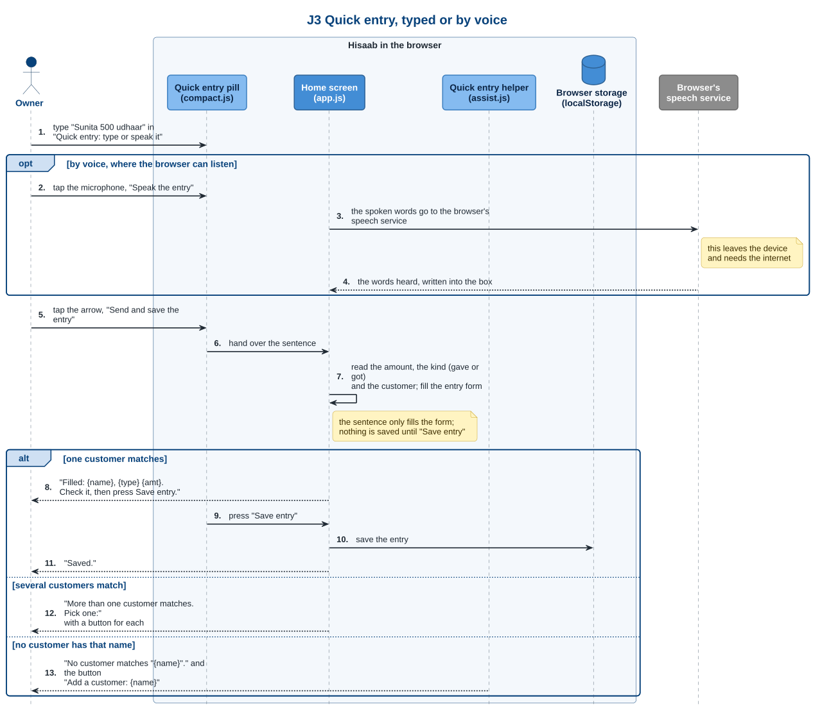
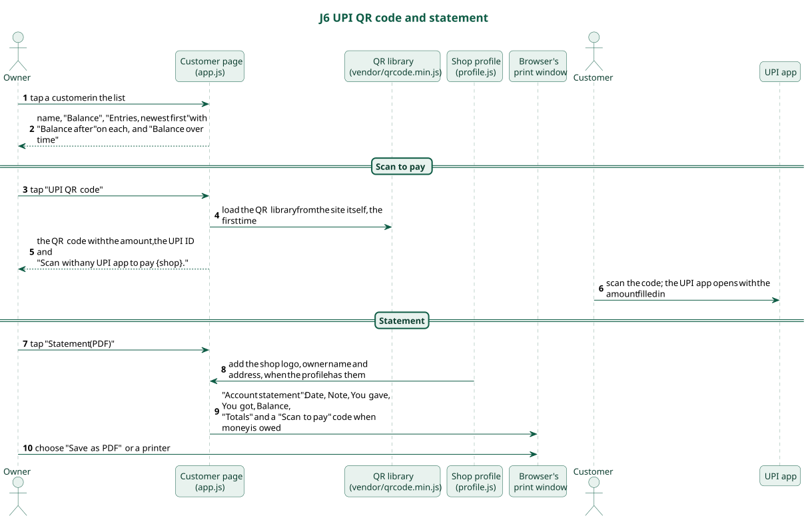
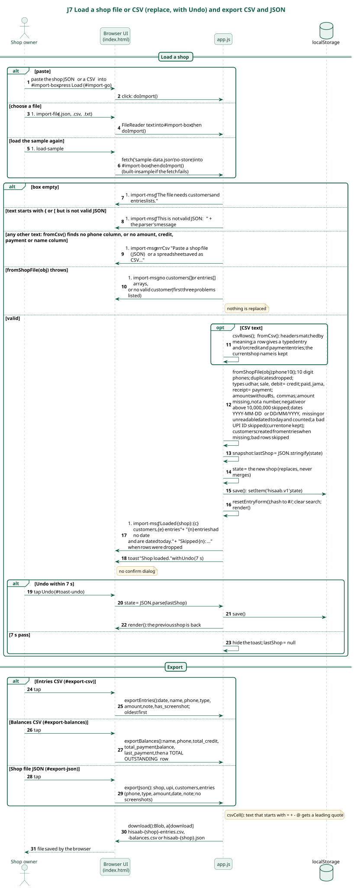
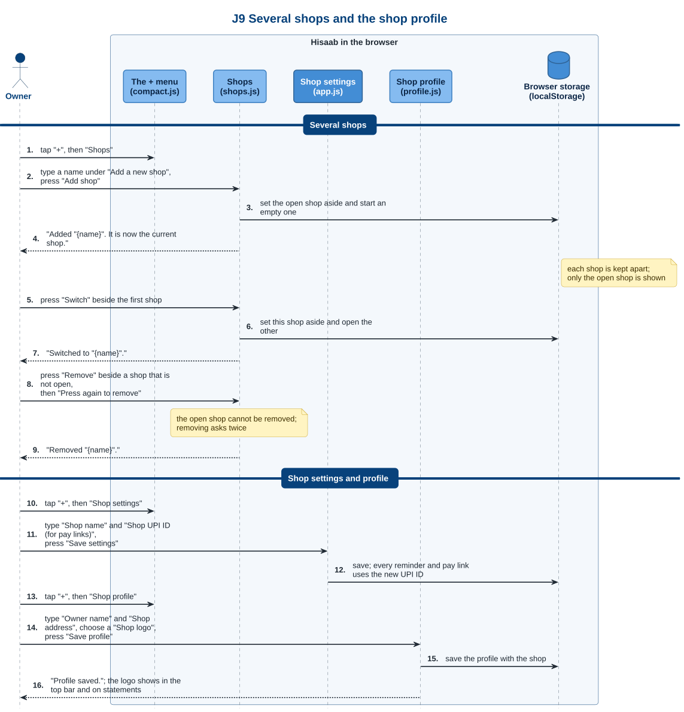
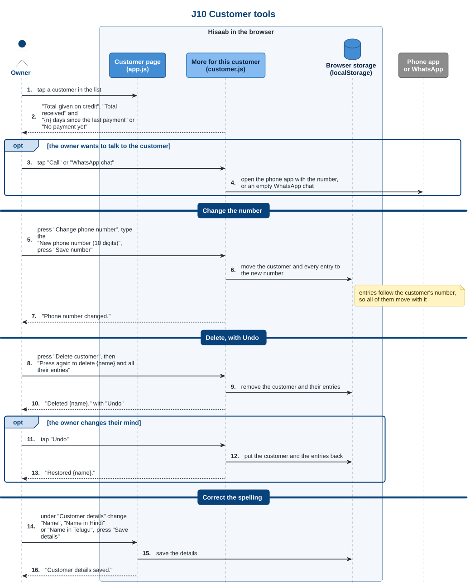
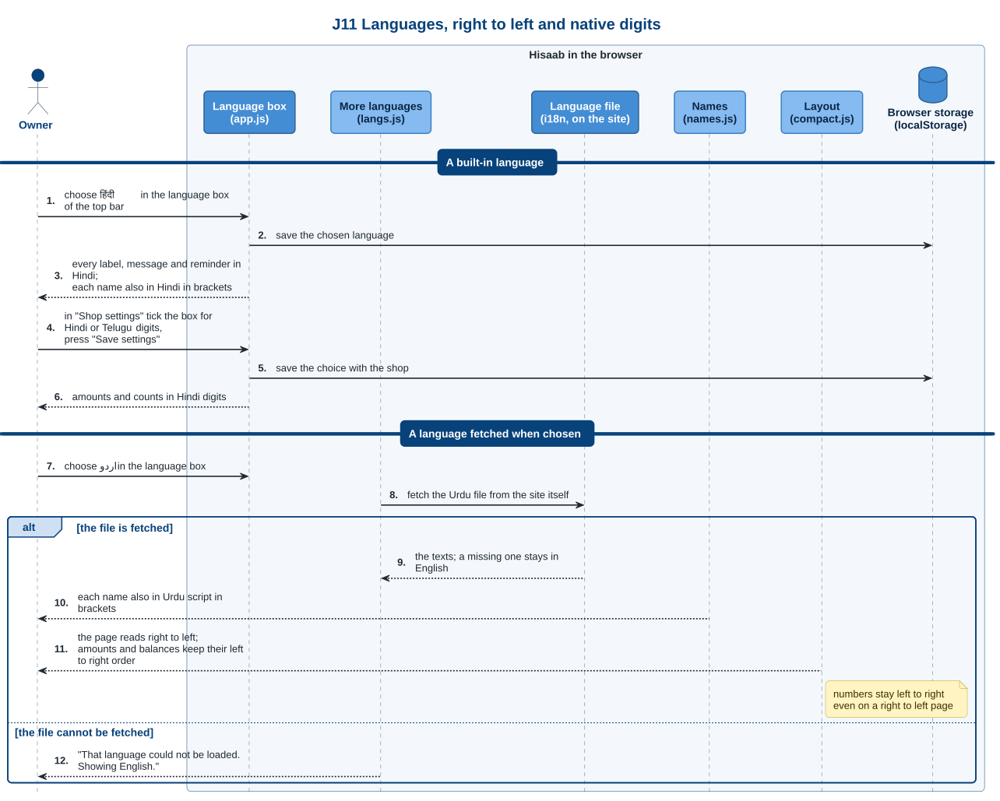
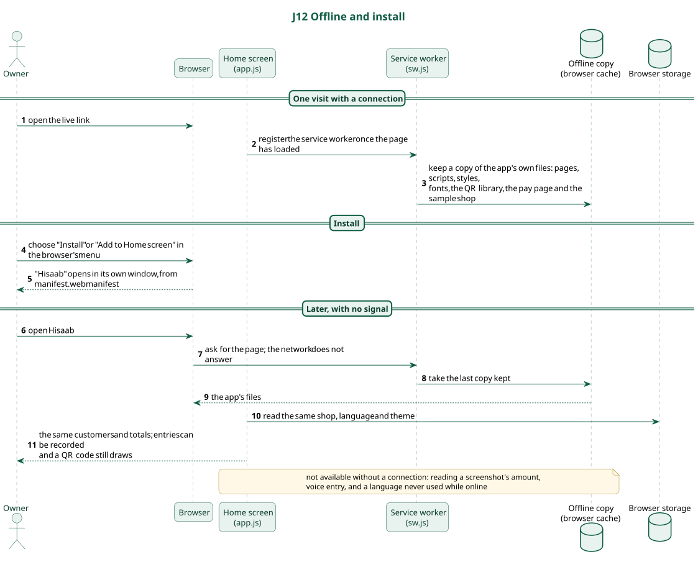

# Hisaab: user journeys

This page describes version 1.5.2, the version on the live link.

Each journey below is something a shop owner does with Hisaab, written as steps you can follow with
[the live link](https://hisaab-hazel.vercel.app) open in another tab. The diagram under each heading shows the
same steps with the same numbers. Start with the first journey: it loads a sample shop, and the others use it.

Three things hold for every journey:

- **The screen.** On a phone the home screen shows "Total outstanding" with a strip of three figures, then the
  customer list, then the quick entry pill fixed at the bottom. The "+" at the start of the pill opens a menu of
  every other action. A desktop shows the same, and from a width of 1200 px it adds a right panel with
  "Record an entry", "Overdue" and "Recent entries". On a desktop the left navigation opens the same views as
  the "+" menu.
- **Where things are kept.** Everything a shop records stays in the browser of the device
  ([where data is kept](data-model.md#where-data-is-kept)). A diagram names "Browser storage" each time
  something is saved there.
- **What leaves the device.** Only what a diagram shows crossing to WhatsApp, an SMS or UPI app, the browser's
  speech service or the address the screenshot reader comes from. The files named in the diagrams are described
  in [the files](../ARCHITECTURE.md#the-files).

| Journey | Who does it and why |
| --- | --- |
| J1 First open and the sample shop | A new owner looks around before entering real customers |
| J2 Add a customer and record an entry | The owner writes down a sale on credit or a payment, and corrects a mistake |
| J3 Quick entry, typed or by voice | The owner records an entry in one sentence while serving |
| J4 WhatsApp reminder with the pay link, and other ways to send | The owner asks one customer to pay, and the customer pays from the message |
| J5 Remind all overdue | The owner works through everyone who has not paid for 30 days or more |
| J6 UPI QR code and statement | A customer pays at the counter, or asks for their account on paper |
| J7 Load a shop file or a CSV, and export | The owner brings a ledger in from a file and takes a copy out |
| J8 Payment screenshot and reading its amount | The owner keeps the customer's proof of payment with the entry |
| J9 Several shops and the shop profile | An owner with two shops keeps both on one device, each under its own name |
| J10 Customer tools | The owner calls a customer, corrects a number or removes a customer |
| J11 Languages, right to left and native digits | The owner reads the ledger in their own language |
| J12 Offline and install | The owner keeps working in a shop with no signal |

## J1 First open and the sample shop

A new owner opens Hisaab for the first time and wants to see a working ledger before typing anything.

1. Open the live link in a browser that has not used Hisaab before.
2. The home screen reads the saved theme, language and shop from the browser.
3. Nothing is saved yet, so it starts an empty shop named "My shop".
4. The screen says "No customers yet. Add your first customer, or load the sample shop to look around." with
   the buttons "Add your first customer" and "Load sample shop".
5. Once the page has loaded, the service worker is registered, which is what later lets the app open offline.
6. Tap "Load sample shop".
7. The sample is fetched from the site itself; a copy inside the app is used if that fails.
8. The shop "Lakshmi Provision Store (fictional)" is saved in the browser.
9. A message says "Loaded Lakshmi Provision Store (fictional): 8 customers, 38 entries." and a bar at the bottom
   says "Shop loaded." with "Undo".
10. The home screen now shows "Total outstanding", the strip "Customers", "Overdue" and "Collected, last 30
    days", the customer list, and the quick entry pill with "+" at the bottom.
11. On a screen 1200 px wide or more, a right panel shows "Record an entry", "Overdue" and "Recent entries",
    each list with its own filter box.
12. Tap "…" at the end of the strip.
13. The full overview opens with "Owes the most", "Collected, last 30 days", "Given on credit, last 30 days"
    and "Longest without paying". The same button, now "−", folds it again.

**What to check**

- The customer list has eight names, those who owe first, and the first row carries the badge "Owes the most".
- Reload the page: the same shop and the same total are there.
- The light or dark button in the top bar changes the theme, and the choice is still there after a reload.

## J2 Add a customer and record an entry

The owner sells on credit to someone new, records it, and later corrects or removes an entry.

1. Tap "+", then "Add a customer".
2. Type a "Name" and a "Phone (10 digits)", then press "Add customer". A number already in the shop is refused
   with "A customer with this phone already exists."
3. The customer is saved in the browser.
4. The screen says "Customer added." and offers to check the number on WhatsApp, which is part of the reminder
   journey below.
5. Tap "+", then "Record an entry". From 1200 px the same form is already open in the right panel.
6. Choose the "Customer", then "You gave (credit)" or "You got (payment)", type the "Amount (₹)", leave or
   change the "Date", add a "Note" (the chips under it fill common notes), and press "Save entry".
7. If the amount has paise, nothing is saved: the form says "Amounts are in whole rupees, without paise. This
   was not saved yet." and offers the button "Use Rs {n}" with the nearest whole amount.
8. Otherwise the entry is saved in the browser.
9. A bar says "Saved." with the link "Send receipt", which opens a WhatsApp message for the customer. The
   customer's balance and "Total outstanding" change at once.
10. Tap the customer in the list, press "Edit" on an entry, change it and press "Update entry".
11. The changed entry is saved.
12. A bar says "Entry updated." with "Undo".
13. Press "Delete" on an entry. There is no second question.
14. The shop is saved without that entry.
15. A bar says "Entry deleted." with "Undo".
16. Tap "Undo" while the bar is showing, about seven seconds.
17. The entry is put back in the same place.

**What to check**

- Add "Ravi Test" with the number 9811111111 and give ₹250 on credit: the row shows a balance of ₹250.
- An amount of 0 gives "Enter an amount above zero." and nothing is saved.
- Delete the entry, tap "Undo": the entry and the balance return.

## J3 Quick entry, typed or by voice

The owner is serving and wants to record an entry in one sentence, typed or spoken.

1. In the pill at the bottom, "Quick entry: type or speak it", type "Sunita 500 udhaar".
2. Or tap the microphone, "Speak the entry". It shows only in a browser that can listen.
3. The spoken words go to the browser's own speech service. This leaves the device and needs the internet.
4. The words heard are written into the box. If nothing was heard the app says "Did not catch that. Try again
   or type it."
5. Tap the arrow at the end of the pill, "Send and save the entry".
6. The pill hands the sentence to the home screen.
7. The app reads the amount, whether it was given or received, and the customer, and fills the entry form. A
   word such as "paid", "jama" or "upi" means a payment; "udhaar" or "gave" means credit; with no such word it
   is taken as credit and the message says so.
8. When one customer matches, the message says "Filled: {name}, {type} {amt}. Check it, then press Save entry."
9. The arrow then presses "Save entry" for you.
10. The entry is saved in the browser.
11. A bar says "Saved."
12. When several customers match, the app asks "More than one customer matches. Pick one:" with a button for
    each.
13. When no customer has that name, a line says "No customer matches "{name}"." with the button "Add a
    customer: {name}", which opens the add form with the name filled in.

**What to check**

- With the sample shop, "Sunita 500 udhaar" and the arrow add ₹500 to Sunita Devi's balance.
- "Sunita 200 paid" lowers it by ₹200.
- "Zubin 100" shows "Which customer? Say the name, for example: Sunita 500 udhaar.", and under it the line
  "No customer matches "Zubin"." and the button "Add a customer: Zubin".

## J4 WhatsApp reminder with the pay link, and other ways to send

The owner asks one customer to pay. The customer pays from the message. If WhatsApp cannot reach the number,
the owner sends the same message another way.

1. Tap the WhatsApp button on a customer's row, or "WhatsApp reminder" on the customer's page.
2. WhatsApp opens a chat with that number and the message typed in: the customer's name, the shop, the balance,
   a "UPI pay link" and a "Pay by UPI" link. A customer who owes nothing gets a message that says so, with no
   pay link.
3. Press Send in WhatsApp. Hisaab never sends by itself; the message leaves the device only at this press.
4. The customer taps the "UPI pay link" in the message.
5. The pay page opens in the customer's browser with "Pay to", the shop, the amount, the button "Open your UPI
   app" and "Copy" for the UPI ID. The shop, the name, the UPI ID and the amount travel inside the link itself.
6. On a phone the page opens the customer's UPI app with the amount filled in.
7. If WhatsApp says the number is not on WhatsApp, open the customer and open "Other ways to send".
8. It offers "Send as SMS", "Choose a contact in WhatsApp" and "Copy the message", all with the same message.
9. To find out before the first reminder, tap "Check on WhatsApp" on the customer's page.
10. WhatsApp opens a chat with a short hello message that names the customer and the shop.
11. Back in Hisaab, answer "Yes, the chat opened" or "No, it said the number is not on WhatsApp".
12. The answer is kept in the browser for that number.
13. The page then reads "Checked: this number is on WhatsApp." or "Not on WhatsApp. Send by SMS, or change the
    number."
14. While the shop has no UPI ID of its own, a notice says "Reminders now ask customers to pay the demo UPI ID
    hisaab.demo@upi, not your shop." with the link "Set your shop's UPI ID".

**What to check**

- The numbers of the sample shop are made up. The customer's page says so and asks you to change the number to
  your own before trying a reminder.
- After that, the WhatsApp button opens a chat with the balance and the pay link in the message, not yet sent.
- Opening the pay link shows the shop name and the same amount.

## J5 Remind all overdue

The owner wants to remind everyone who has not paid for 30 days or more, one chat after another.

1. Open "Overdue" (in the right panel, the left navigation or the "+" menu). The list holds everyone who owes,
   longest without paying first, with "30+ days" on those at 30 days or more.
2. A line above the list gives the amount unpaid for 30 days or more and from how many customers.
3. Tap "Remind all overdue (N)". The button shows when two or more customers are at 30 days or more. The "+"
   menu has the same action.
4. WhatsApp opens the first customer's chat with the reminder typed in.
5. Press Send in WhatsApp and come back to Hisaab.
6. The button now reads "Next reminder: {name} ({i} of {n})".
7. Tap the button again.
8. WhatsApp opens the next customer's chat. Repeat for each customer left.
9. After the last one the button reads "All {n} reminders opened".

**What to check**

- The number in "Remind all overdue (N)" equals the number of rows with "30+ days".
- Each press opens one chat and moves the label to the next name.

## J6 UPI QR code and statement

A customer at the counter wants to pay by scanning, or asks for their account on paper.

1. Tap a customer in the list.
2. The customer's page shows the name, the "Balance", "Entries, newest first" with "Balance after" on each
   entry, and the chart "Balance over time".
3. Tap "UPI QR code". The button shows only when the customer owes money.
4. The QR library is loaded from the site itself the first time.
5. The code appears with the amount, the UPI ID and "Scan with any UPI app to pay {shop}."
6. The customer scans it, and their UPI app opens with the amount filled in.
7. Tap "Statement (PDF)".
8. The shop's logo, owner name and address are added when the shop profile has them.
9. The browser's print window opens with the "Account statement": a table of Date, Note, You gave, You got and
   Balance, the "Totals", and a "Scan to pay" code when money is owed.
10. Choose "Save as PDF" or a printer in that window.

**What to check**

- The amount under the QR code is the customer's balance.
- The last balance in the statement table equals the "Balance" on the page.
- A customer who owes nothing has no "UPI QR code" button.

## J7 Load a shop file or a CSV, and export

The owner brings a ledger in from a backup file or a spreadsheet, and takes a copy out.

1. Tap "+", then "Import a shop".
2. Paste a shop file (JSON) or a spreadsheet saved as CSV into the box, or use "Choose file", then press "Load
   shop".
3. The app reads it and cleans phones, kinds, amounts and dates. A row it cannot use is skipped, and an entry
   with no readable date is dated today.
4. The loaded shop replaces the current one in the browser. Nothing is merged.
5. Amounts with paise are rounded to whole rupees, and a picture that is not an image or is too large is left
   out while its entry is kept.
6. A message says "Loaded {shop}: {c} customers, {e} entries." and lists what was skipped or changed. A bar
   says "Shop loaded." with "Undo".
7. If it was the wrong file, tap "Undo" while the bar is showing.
8. The earlier shop is put back.
9. To take data out, press "Export entries (CSV)", "Export balances (CSV)" or "Backup file (JSON)" in the same
   view.
10. A file named after the shop is downloaded to the device. The backup file leaves out screenshots.

**What to check**

- Press "Backup file (JSON)", then load that file again: the same customers and the same total return.
- Text that is not a shop file gives a message that names what is missing, and the current shop is untouched.
- "Export balances (CSV)" ends with a row "TOTAL OUTSTANDING" that equals the total on the home screen.

## J8 Payment screenshot and reading its amount

A customer shows a payment screenshot. The owner keeps it with the entry and lets the app read the amount.

1. In the entry form, under "Payment screenshot (optional)", press "Choose screenshot" and pick the picture.
2. The form switches to "You got (payment)" and the picture is shrunk to at most 600 px on its longest side.
3. The form says "Reading the amount from the screenshot...".
4. The first time, the reader is fetched from `cdn.jsdelivr.net`. That request leaves the device. The picture
   does not: it is read in the browser.
5. The reader returns the text it found in the picture.
6. When an amount is found, the form fills it and says "Read Rs {amt} from the screenshot. Check it before
   saving." An amount you typed yourself is not overwritten.
7. When nothing can be read, or there is no internet, it says "Could not read an amount from this picture. Type
   it in."
8. Check "Amount (₹)" and press "Save entry".
9. The entry is saved in the browser with the small picture.
10. The picture shows on the entry in the customer's list of entries.

**What to check**

- A file that is not a picture gives "That file is not a picture."
- After saving, the entry carries a small picture.
- "Remove" beside "Choose screenshot" takes the picture off before saving.

## J9 Several shops and the shop profile

An owner with two shops keeps both on one device, each with its own ledger, name, UPI ID and logo.

1. Tap "+", then "Shops".
2. Under "Add a new shop" type a name and press "Add shop".
3. The open shop is set aside in the browser and an empty one is started.
4. The app says 'Added "{name}". It is now the current shop.'
5. Press "Switch" beside the first shop. The open one carries the mark "Current".
6. This shop is set aside in the browser and the other one is opened.
7. The app says 'Switched to "{name}".' and the home screen shows that shop's customers and total.
8. Press "Remove" beside a shop that is not open, then "Press again to remove".
9. The app says 'Removed "{name}".'
10. Tap "+", then "Shop settings".
11. Type the "Shop name" and the "Shop UPI ID (for pay links)", then press "Save settings".
12. They are saved, and every reminder and pay link uses the new UPI ID.
13. Tap "+", then "Shop profile".
14. Type the "Owner name" and "Shop address", choose a "Shop logo" and press "Save profile".
15. The profile is saved with the shop.
16. The app says "Profile saved." The logo shows in the top bar and on statements.

**What to check**

- A new shop starts empty, and switching back shows the first shop's total unchanged.
- A UPI ID such as "abc" is refused with "Enter a UPI ID like shopname@okbank, or leave it empty."
- "Import as a new shop" in the shop file view loads a file as one more shop and leaves the open one as it was.

## J10 Customer tools

The owner wants a customer's totals, a quick call, a corrected number, or to remove a customer added by mistake.

1. Tap a customer in the list.
2. "More for this customer" shows "Total given on credit", "Total received" and "{n} days since the last
   payment" or "No payment yet".
3. Tap "Call" or "WhatsApp chat".
4. The phone app opens with the number, or WhatsApp opens an empty chat.
5. Press "Change phone number", type the "New phone number (10 digits)" and press "Save number".
6. The customer and every entry of theirs move to the new number.
7. The page says "Phone number changed."
8. Press "Delete customer", then within five seconds "Press again to delete {name} and all their entries".
9. The customer and their entries are removed from the browser.
10. The home screen opens with a bar "Deleted {name}." and "Undo" for eight seconds.
11. Tap "Undo".
12. The customer and the same entries are put back.
13. The bar says "Restored {name}."
14. Under "Customer details" change the "Name", "Name in Hindi" or "Name in Telugu" and press "Save details".
15. The details are saved.
16. The page says "Customer details saved."

**What to check**

- A number that another customer has is refused with "Another customer already has this number."
- After a delete, "Total outstanding" falls by that customer's balance; after "Undo" it is back.
- After a change of number, the entries and the balance are the same under the new number.

## J11 Languages, right to left and native digits

The owner reads the ledger in one of twelve languages, with numbers in Hindi or Telugu digits if wanted.

1. Choose हिंदी in the language box of the top bar. On a phone it is the round language button beside the
   theme button; "Language" in the "+" menu goes to the same box.
2. The choice is saved in the browser.
3. Every label, message and reminder is in Hindi, and each customer's name is also written in Hindi in
   brackets.
4. Open "Shop settings", tick the box for Hindi or Telugu digits and press "Save settings". The box shows only
   in Hindi and Telugu.
5. The choice is saved with the shop.
6. Amounts and counts are shown in Hindi digits.
7. Now choose اردو in the language box.
8. Urdu is one of nine languages that are not built in: its file is fetched from the site itself when chosen.
9. The texts arrive; one that the file lacks stays in English.
10. Each customer's name is also written in Urdu script in brackets.
11. The page reads right to left. Amounts and balances keep their left to right order.
12. If the file cannot be fetched, the app stays in English and says "That language could not be loaded.
    Showing English."

**What to check**

- "Total outstanding" is the same figure in every language.
- In Urdu the list and the menu are mirrored; back in English the page reads left to right again.
- After a reload the app opens in the language chosen last.

## J12 Offline and install

The shop has no signal on some days. The owner opened Hisaab once with a connection and wants to keep working.

1. Open the live link with a connection.
2. Once the page has loaded, the service worker is registered.
3. It keeps a copy of the app's own files in the browser: pages, scripts, styles, fonts, the QR library, the pay
   page and the sample shop.
4. To install, choose "Install" or "Add to Home screen" in the browser's menu. Hisaab has no install button
   of its own: the menu item and its wording are the browser's, and differ from one browser to another.
5. "Hisaab" then opens in its own window with its own icon.
6. Later, with no signal, open Hisaab.
7. The browser asks for the page and the network does not answer.
8. The service worker takes the last copy it kept.
9. The app's files come from that copy.
10. The same shop, language and theme are read from the browser.
11. The same customers and totals are on the screen. Entries can be recorded and a QR code still draws.

Three things need a connection: reading the amount from a screenshot, voice entry, and a language that was
never used while online.

**What to check**

- Load the page once, switch the device to flight mode and reload: the ledger opens with the same total.
- Record an entry offline, go back online and reload: the entry is there.
- Offline, "UPI QR code" on a customer who owes still draws the code.
