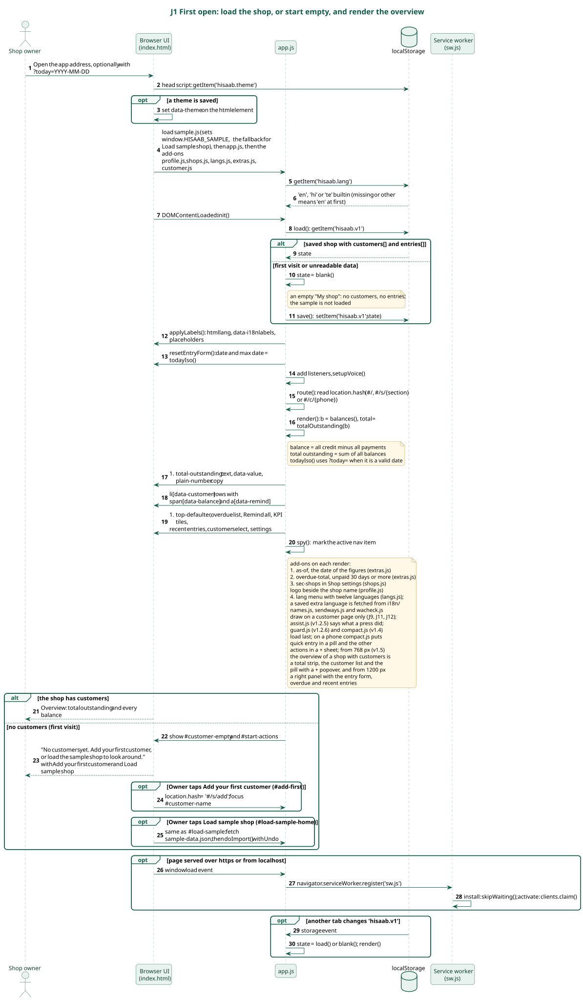

# Hisaab: user journeys

This page walks through what the shop owner does with Hisaab and what the app does in reply. Each journey
is drawn from `app.js`, `index.html` and `sw.js` as built: the function names, the order of calls, what is
read from and written to `localStorage`, and the links that open. Nothing here is planned work.

Every diagram is a PlantUML sequence diagram rendered to SVG. Participants appear in the same order in
each one: Shop owner, Browser UI (`index.html`), `app.js`, `localStorage`, Service worker (`sw.js`), the
library loaded from a CDN, and WhatsApp or a UPI app. A diagram shows only the participants it uses.

To render again, from the project folder:

```
java -jar /c/Projects/2027/Cursor/vmo2-ai-sdlc-pack/src/plantuml.jar -tsvg -charset UTF-8 docs/diagrams/j*.puml
```

Epics: E1 Customers and entries, E2 Shop overview, E3 Reminders and getting paid, E4 Customer page and
statement, E5 Quick entry, E6 Shop data, E7 Languages, themes and layout, E8 Navigation, offline and the
grader contract.

## The journeys

| ID | Name | Who | Trigger | Outcome | Epics |
| --- | --- | --- | --- | --- | --- |
| J1 | First open | Shop owner (or a tester) | Opens the app, optionally with `?today=` | Overview with the total outstanding and every balance; on a first visit an empty shop with two buttons, Add your first customer and Load sample shop | E2, E6, E7, E8 |
| J2 | Record an entry | Shop owner | Fills the entry form and presses Save, or taps Edit or Delete | Entry saved, changed or removed; balances re-rendered; Undo after an edit or a delete | E1, E3 |
| J3 | Quick entry by voice or typing | Shop owner | Taps the mic or types "Sunita 500 udhaar" | Entry form filled and Save focused; the owner saves | E5, E1, E7 |
| J4 | WhatsApp reminder | Shop owner, then the customer | Taps the WhatsApp button on a customer row | WhatsApp opens with the name, balance and UPI pay link; the owner presses Send | E3 |
| J5 | Remind all overdue | Shop owner | Taps "Remind all overdue" | One chat per overdue customer, longest overdue first | E3, E2 |
| J6 | UPI QR and statement | Shop owner, then the customer | Opens a customer page, taps UPI QR code or Statement | QR drawn in the page; statement printed or saved as PDF with a scan-to-pay QR | E4, E3 |
| J7 | Load a shop file and export | Shop owner (or a tester) | Pastes a shop file or a CSV into `#import-box` and presses `#import-go`, or taps an export button | Shop replaced after checks, with Undo; CSV or JSON file downloaded | E6, E8 |
| J8 | Payment screenshot | Shop owner | Chooses a screenshot in the entry form | Picture shrunk and kept on the entry; amount read and offered for checking | E1, E3, E8 |
| J9 | Language and offline | Shop owner | Picks a language; later opens the app with no signal | Labels in English, Hindi or Telugu, kept after reload; the app opens offline with the same shop | E7, E8 |

All nine journeys asked for are supported by the code; none was dropped or merged.

## J1 First open

**Goal.** See at a glance how much the shop is owed in total and by whom; on a first visit, start a new
ledger or look around the sample shop.

**Preconditions.** A browser with `localStorage`. The service worker only registers over https or on
localhost.

**Steps.**
1. The head script in `index.html` reads `hisaab.theme` and sets light or dark before anything draws.
2. `sample.js` sets `window.HISAAB_SAMPLE` (used only as the fallback for Load sample shop); `app.js` reads
   `hisaab.lang` (English when missing).
3. `init()` calls `load()`, which reads `hisaab.v1`. A saved shop is used as it is.
4. On a first visit, or when the saved data cannot be read, `blank()` gives an empty shop ("My shop", no
   customers, no entries) and it is saved. The sample is not loaded: the brief's "Done when" lines add
   Ravi Kumar 9000000101 to a fresh app and expect Rs 250 after a Rs 250 credit.
5. `applyLabels()` sets the language; `resetEntryForm()` sets the date and the latest allowed date to
   `todayIso()`, which uses `?today=` when it is a valid date.
6. `route()` reads the address (`#/`, `#/s/{section}` or `#/c/{phone}`) and calls `render()`.
7. `render()` works out every balance (all credit minus all payments) and the total outstanding (the sum
   of all balances), then fills `#total-outstanding` (with `data-value` and a plain number copy), one `li[data-customer]` per customer with `span[data-balance]` and `a[data-remind]`, the
   top defaulter, the overdue list, the KPI tiles, the recent entries and the customer list in the form.
   With no customers it shows "No customers yet. Add your first customer, or load the sample shop to look
   around." and two buttons: `#add-first` opens `#/s/add` and focuses the name field, and
   `#load-sample-home` does the same as Load sample shop on the Shop file card (J7).
8. After the page's load event, `sw.js` is registered; it takes control at once (`skipWaiting`,
   `clients.claim`).



Source: [j1-first-open.puml](diagrams/j1-first-open.puml)

**Error and edge paths.**
- An invalid `?today=` value is ignored and the device date is used.
- If another tab changes `hisaab.v1`, the `storage` event reloads the state and renders again.
- When some customers are in advance, `#total-outstanding` still holds one figure (the sum of all
  balances); the note `#total-note` just below it, outside it, gives the amount owed and the advance, and
  those rows show an "Advance" label with the balance drawn as -₹200 (text ₹-200).

## J2 Record a credit or payment; edit and delete

**Goal.** Record a sale on credit or a payment in seconds, and correct mistakes safely.

**Preconditions.** At least one customer. A new customer can be added first with the Add customer form.

**Steps.**
1. Optional: the owner adds a customer. `onAddCustomer()` needs a name and a phone of only digits,
   spaces and + ( ) - . that is 10 digits after `phone10()` strips `+91` or a leading `0` (`validPhone()`)
   and that no other customer has; it saves, renders and selects the new customer in the entry form.
2. The owner picks the customer (on a customer page it is fixed), Credit or Payment, the amount, the date
   and a note, and presses Save entry.
3. `onEntrySubmit()` checks, in this order: a customer is chosen, the amount is above zero, the amount is
   at most ₹1,00,00,000, the date is valid, the date is not after today.
4. A new entry is pushed with an id and a sequence number; an edited entry is first copied
   (`lastEdited`), then changed in place.
5. `save()` writes the whole shop to `hisaab.v1`; the form resets (the customer stays); `render()` redraws
   every figure.
6. A toast says "Saved." with a "Send receipt" link: a `wa.me` message with the amount, the date and the
   new balance. The owner presses Send in WhatsApp; the app never sends by itself.
7. Edit: the Edit button calls `startEdit()`, which fills the form and turns Save into Update; Cancel
   clears the form. After Update the toast says "Entry updated." with Undo and the "Send receipt" link for
   7 seconds; Undo puts the old entry back in place.
8. Delete: the Delete button calls `deleteEntry()` straight away (no confirm dialog), saves, renders and
   shows "Entry deleted." with Undo for 7 seconds. Undo puts the entry back where it was.


Source: [j2-record-entry.puml](diagrams/j2-record-entry.puml)

**Error and edge paths.**
- Each failed check shows its message in `#entry-msg` and focuses the field; nothing is saved.
- Add customer with a phone that has letters or other symbols, or is not 10 digits after clean-up:
  "Enter a 10 digit phone number, digits only." and nothing is saved.
- Add customer with a 10 digit number that does not start with 6, 7, 8 or 9: the customer is added and
  "Customer added." is followed by "Check the number: Indian mobile numbers start with 6, 7, 8 or 9, so
  WhatsApp may not reach this one." (`validMobile()`). Loading a shop file (J7) accepts any 10 digits
  with no warning.
- If `localStorage` is full, a toast says "Storage is full. Export a backup, then remove some screenshots."
- Saving a new entry has no Undo; Undo is offered after an edit, after a delete and after loading a shop
  (J7). After 7 seconds the toast closes and the change can no longer be undone; a delete or an import
  also clears the Undo of an edit.

## J3 Quick entry by voice or typing

**Goal.** Say or type one short phrase, such as "Sunita 500 udhaar", and have the form filled.

**Preconditions.** The mic button shows only when the browser has `SpeechRecognition` or
`webkitSpeechRecognition`; typing always works.

**Steps.**
1. The owner taps the mic. `app.js` starts recognition in `hi-IN`, `te-IN` or `en-IN` to match the app
   language, and shows "Listening...".
2. The words heard are written into `#quick-input` as they come. When recognition ends with words heard,
   `onQuick()` runs. Typing a phrase and pressing Fill (or Enter) runs `onQuick()` the same way.
3. `parseQuick()` reads the phrase: Hindi and Telugu digits become 0 to 9; ₹, Rs and commas are dropped;
   the first number is the amount, and hazaar, sau, lakh, thousand or hundred after it multiply it; a
   payment word (paid, jama, mila, UPI, GPay) makes it a payment, a credit word (udhaar, diya, baki) a
   credit; the remaining words are scored against each customer's name in English, Hindi and Telugu
   script, and against the phone or its last four digits; leftover words become the note.
4. `applyQuick()` fills the customer, type, amount, date (if empty) and note, says "Filled: ... Check it,
   then press Save entry." and moves the focus to Save entry. Nothing is saved yet.
5. The owner checks the form and presses Save entry, which follows J2.


Source: [j3-quick-entry-voice.puml](diagrams/j3-quick-entry-voice.puml)

**Error and edge paths.**
- Several customers tie: "More than one customer matches. Pick one:" with up to six buttons; tapping one
  fills the form.
- No customer matches: "Which customer? Say the name...".
- A customer but no amount: the customer is selected, "Say or type an amount..." is shown and Amount gets
  the focus.
- No type word: the entry is taken as credit, and the message says so.
- On a customer page the customer is already known, so only the amount, type and note are read.
- Recognition errors show "Did not catch that..." (no speech) or "Could not use the microphone...".
- Amounts must be said or typed as digits; number words such as "paanch" are not read.

## J4 WhatsApp reminder

**Goal.** Ask a customer to pay in one tap, with the right amount and a way to pay.

**Preconditions.** The customer has a 10 digit Indian number. The shop's UPI ID is set in Shop settings;
until then the demo ID `hisaab.demo@upi` is used and Settings says so. Settings checks the UPI ID with
`validUpi()` (`name@handle`, for example `shopname@okbank`); a bad ID shows "Enter a UPI ID like
shopname@okbank, or leave it empty." and nothing is saved. Empty is allowed.

**Steps.**
1. At every render, each row's `a[data-remind]` gets its link: `https://wa.me/91{phone}?text=` and the
   message from `reminderText()`.
2. When the customer owes money, the message gives the name, the shop, the balance and a UPI pay link,
   `upi://pay?pa={UPI ID}&pn={shop}&am={balance}&cu=INR&tn=Hisaab {name}`.
3. The owner taps the WhatsApp button. It is a plain link; WhatsApp (or WhatsApp Web) opens the chat with
   the message typed in.
4. The owner presses Send in WhatsApp. The app never sends by itself.
5. The customer can pay from the UPI link; the owner then records the payment (J2).


Source: [j4-whatsapp-reminder.puml](diagrams/j4-whatsapp-reminder.puml)

**Error and edge paths.**
- A customer in advance gets a message stating the advance; a settled customer gets "Your account is
  settled, Rs 0 due."; neither contains a pay link.
- Changing the shop name or UPI ID in Settings rebuilds every link at the next render.
- The customer page has the same reminder (`#cust-remind`) and a UPI pay link button (`#cust-upi`, shown
  only when money is owed).
- The message follows the app language.

## J5 Remind all overdue

**Goal.** Work through everyone who owes money, longest overdue first, without searching for each.

**Preconditions.** At least two customers with a balance above zero; with fewer the button stays hidden.

**Steps.**
1. `overdueRows()` lists customers who owe money, with the days since their last payment (or since their
   first credit when they never paid), counted to `todayIso()`; most days first, then the larger balance.
2. `renderRemindAll()` keeps a queue of their phones, labels the button "Remind all overdue (n)" and
   points its link at the first customer's `wa.me` reminder.
3. The owner taps the button. The click handler `remindNextOne()` moves the queue on by one, the link
   opens the current chat in a new tab, and straight after (`setTimeout` 0) the button's link moves to the
   next customer and reads "Next reminder: {name} (i of n)".
4. In each chat the owner presses Send in WhatsApp, then comes back and taps again.
5. After the last one the button reads "All n reminders opened".


Source: [j5-remind-all.puml](diagrams/j5-remind-all.puml)

**Error and edge paths.**
- Tapping after the last reminder starts the queue again from the top.
- If an entry changes who is overdue, the queue is rebuilt and starts again at the first customer.
- The app opens chats only; nothing is sent without the owner.

## J6 UPI QR code and statement

**Goal.** Let a customer at the counter scan to pay, and give a customer a printed or PDF statement.

**Preconditions.** A customer page is open (`#/c/{phone}`). The QR button shows only when the customer
owes money. The QR library needs a network connection the first time.

**Steps.**
1. Tapping a customer opens `#/c/{phone}`; `route()` shows the customer page and `renderCustomer()` fills
   the name, phone, balance, last payment and the entries with the running balance after each.
2. UPI QR code: `showQr()` opens the card with the amount and UPI ID. `loadQr()` adds
   `qrcode-generator` 1.4.4 from cdnjs the first time, then `qrSvg()` draws the `upi://pay` link as an SVG
   QR code in the page. Tapping again closes it.
3. Statement (PDF): the app waits for the QR library for at most 1.5 seconds, then `printStatement()`
   builds the statement (shop, customer, date, entries oldest first with gave, got and balance, totals),
   adds a scan-to-pay QR when money is owed and the library is loaded, and calls `window.print()`.
4. The browser's print dialog lets the owner print or save as PDF; afterwards the page returns to normal.


Source: [j6-qr-and-statement.puml](diagrams/j6-qr-and-statement.puml)

**Error and edge paths.**
- If the library cannot load (offline or blocked), the card shows the `upi://pay` link as text, and the
  next tap tries to load it again.
- If the library is not ready within 1.5 seconds, the statement prints without the QR code.
- A customer with nothing owed has no QR button and no QR on the statement.

## J7 Load a shop file and export

**Goal.** Replace the shop with another shop file or a spreadsheet, safely, and take the data out as CSV
or JSON.

**Preconditions.** For loading, a shop file in JSON with `customers` and `entries` lists, or a spreadsheet
saved as CSV or tab-separated text with a phone column and at least one of amount, credit, payment or
name.

**Steps.**
1. The owner pastes the file into `#import-box` and presses `#import-go` (Load). Choosing a `.json`,
   `.csv` or `.txt` file, or "Load sample", puts the text in the same box and loads it the same way.
2. `doImport()` reads text that starts with `{` or `[` as JSON and anything else as CSV: `csvRows()` and
   `fromCsv()` match the headers by meaning (see [Importing a CSV](schema/export-entries.csv.md#importing-a-csv))
   and turn the rows into a shop object, keeping the current shop name.
3. `fromShopFile()` checks it: phones cut to 10 digits, duplicates dropped, Hindi words for credit and
   payment accepted, amounts with Rs or commas cleaned, an amount that is missing, blank, not a number,
   negative or above 10,000,000 skipped, dates as YYYY-MM-DD or DD/MM/YYYY, a missing or unreadable date
   set to today and counted, a bad UPI ID in the file skipped (the current one is kept), customers created
   from entries when missing, bad rows skipped.
4. The current shop is kept as a snapshot, the new shop replaces it (no merge), is saved to `hisaab.v1`,
   and the overview is rendered.
5. The message gives the shop name and the counts of customers and entries, then "{n} entries had no date
   and are dated today." when any were, then "Skipped {n}: " with the first three skipped rows (translated
   in English, Hindi and Telugu); a toast "Shop loaded." offers Undo for 7 seconds, which restores the
   snapshot.
6. Export: Entries CSV, Balances CSV (with a TOTAL OUTSTANDING row) or the shop file as JSON, each
   downloaded through a Blob link named after the shop.


Source: [j7-import-export.puml](diagrams/j7-import-export.puml)

**Error and edge paths.**
- An empty box or a file without the two lists: "The file needs customers and entries lists."; invalid
  JSON: "This is not valid JSON: " and the parser's message; a CSV without a phone column, or with no
  amount, credit, payment or name column: "Paste a shop file (JSON) or a spreadsheet saved as CSV with
  name, phone, type, amount and date columns." Nothing is replaced.
- Amount 0 and future dates are accepted on import; impossible dates such as 2026-02-30 are kept.
- A file in which no customer is valid is refused with the first three problems listed; a file with some
  bad rows loads and lists what was skipped.
- There is no confirm dialog; Undo is the safety net.
- CSV cells that start with `=`, `+`, `-` or `@` get a leading quote so a spreadsheet does not run them.
- The JSON export leaves out screenshots.
- The Entries CSV loads back through the same box to the same totals.

## J8 Payment screenshot

**Goal.** Keep the customer's payment screenshot on the entry, and save typing by reading the amount
from it.

**Preconditions.** The entry form is open. Reading the amount needs a network connection to load
Tesseract.js.

**Steps.**
1. The owner chooses a picture in `#shot-input`. `onShotChange()` sets the type to Payment.
2. The picture is drawn on a canvas at most 640 px on its longest side, on white, and kept as a JPEG at
   quality 0.72; a preview shows.
3. `readAmount()` loads Tesseract.js 5.1.1 the first time and reads the original picture in the app
   language: `eng` for English, `eng+hin` for Hindi, `eng+tel` for Telugu, falling back to `eng` if the
   combined language fails to load.
4. `qNorm()` turns Devanagari and Telugu digits into 0 to 9. `pickAmount()` prefers a number after ₹, Rs,
   INR, "amount", "paid", रु, रुपये, राशि, రూ, మొత్తం or భుగతాన, otherwise the largest plain number
   that is not a year. A Hindi screenshot reading "भुगतान रु ४५०" fills 450. The amount goes into the Amount field only if the field is empty or was filled by
   the reader, with "Read Rs {amt} from the screenshot. Check it before saving."
5. The owner checks the amount and presses Save entry (J2). The small JPEG is stored on the entry inside
   `hisaab.v1`, and the entry shows it as `img[data-shot]`.


Source: [j8-payment-screenshot.puml](diagrams/j8-payment-screenshot.puml)

**Error and edge paths.**
- A file that is not a picture: "That file is not a picture."
- No amount found, or the library cannot load: "Could not read an amount from this picture. Type it in."
- Once the owner types in Amount, the reader no longer overwrites it.
- Remove picture clears it; on Update the picture is removed from the entry. Editing without a new
  picture keeps the old one.
- Pictures fill `localStorage` fastest; when it is full, the app says to export a backup and remove some
  screenshots.
- Unlike the QR library, Tesseract.js is loaded from jsDelivr (`cdn.jsdelivr.net`), not from cdnjs.
- Tesseract.js downloads its language data on first use; neither is cached for offline.

## J9 Language and offline

**Goal.** Use the app in English, Hindi or Telugu, and keep working in a shop with no signal.

**Preconditions.** For offline use the app has been opened online over https (or on localhost) once, so
the service worker has installed and cached the app shell.

**Steps.**
1. The owner picks English, हिंदी or తెలుగు. The choice is saved as `hisaab.lang`; `applyLabels()`
   changes every label and placeholder and `render()` redraws: names with the local script in brackets,
   dates in the chosen locale, reminders and receipts in the chosen language.
2. Optional: Hindi or Telugu digits (`#native-digits`, saved in the shop) and the light or dark theme
   (`hisaab.theme`).
3. On install `sw.js` precaches the app shell (`./`, `index.html`, `styles.css`, `app.js`, `sample.js`,
   `sample-data.json`, `icon.svg`, `manifest.webmanifest`) in the `hisaab-v2` cache; on activate it deletes
   older caches.
4. While online, `sw.js` answers each GET to the app's own origin, to `qrcode-generator` on cdnjs and to
   Google Fonts from the network first and keeps a copy in `hisaab-v2`.
5. With no signal the network request fails and `sw.js` returns the cached copy (ignoring the query, so
   `?today=` still works), or `index.html`.
6. `init()` reads the same language and the same shop from `localStorage`, so the owner carries on.


Source: [j9-language-offline.puml](diagrams/j9-language-offline.puml)

**Error and edge paths.**
- The service worker registers after the first page load and precaches the shell when it installs, so
  one online visit is enough: offline, the ledger opens with the same totals. The QR code draws offline
  once the QR library has loaded online and been cached.
- Tesseract.js (jsDelivr) is not cached by `sw.js`; offline, the screenshot reader says it could not read
  an amount. If the QR library was never loaded online, the QR card shows the pay link as text.
- An unknown saved language falls back to English.
